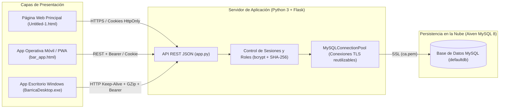
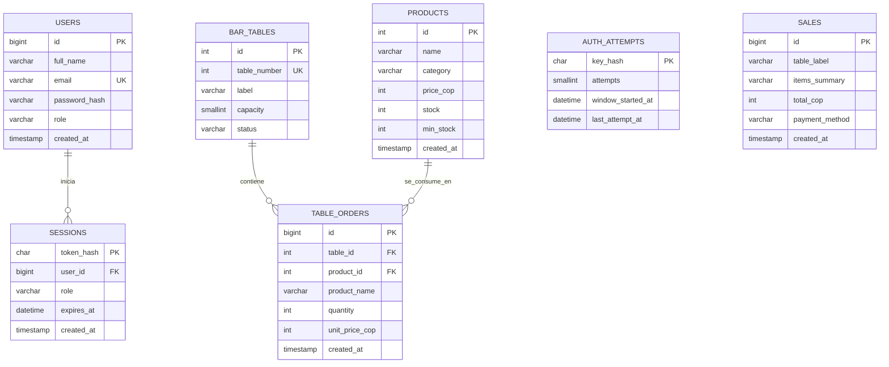
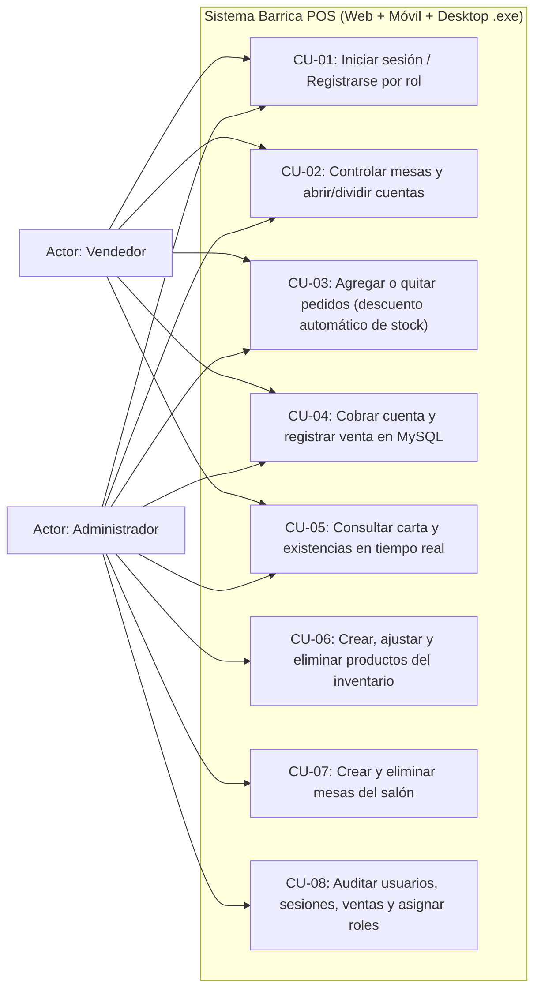
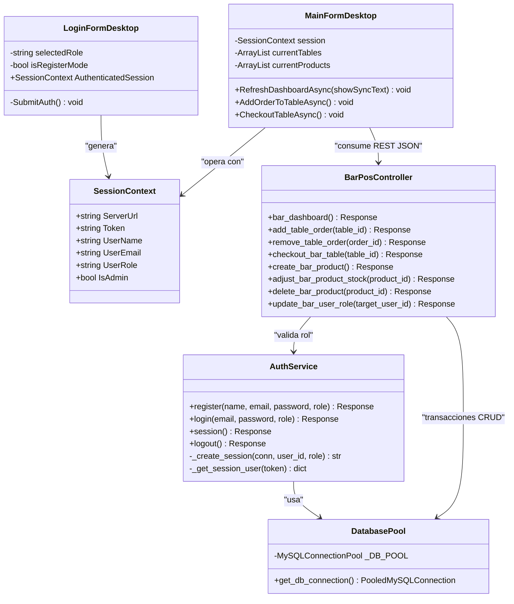
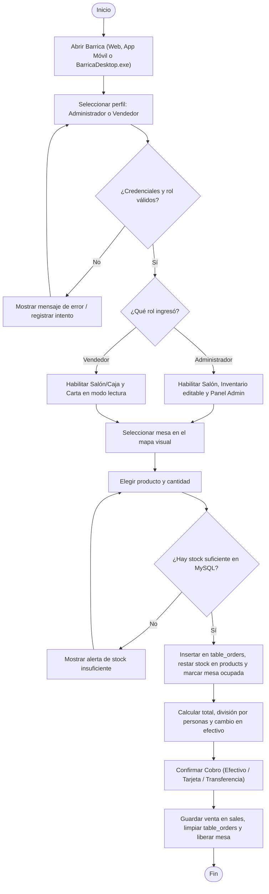
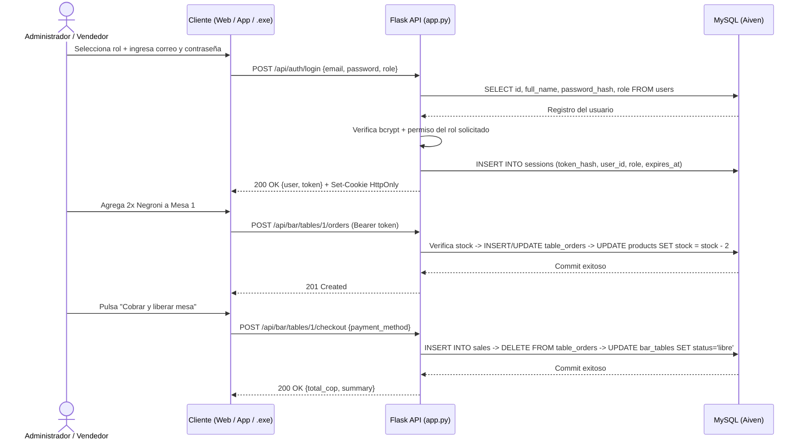

# Documentación Técnica del Proyecto — Barrica POS

Este documento reúne los artefactos de ingeniería de software y bases de datos del sistema **Barrica** (Sistema Operativo y POS para Bares conectado a **MySQL** con backend en **Python / Flask**, interfaz web/móvil en **HTML5/CSS3/JS** y aplicación nativa de escritorio en **C# WinForms**).

---

## Índice

1. [Arquitectura General del Sistema](#1-arquitectura-general-del-sistema)
2. [Diagrama Entidad-Relación (DER)](#2-diagrama-entidad-relación-der)
3. [Modelo Relacional (MR)](#3-modelo-relacional-mr)
4. [Diccionario de Datos](#4-diccionario-de-datos)
5. [Diagramas UML](#5-diagramas-uml)
   - [5.1 Diagrama de Casos de Uso](#51-diagrama-de-casos-de-uso)
   - [5.2 Diagrama de Clases](#52-diagrama-de-clases)
   - [5.3 Diagrama de Actividades](#53-diagrama-de-actividades)
   - [5.4 Diagrama de Secuencias](#54-diagrama-de-secuencias)
6. [Documentación de Casos de Uso](#6-documentación-de-casos-de-uso)
7. [Mockups Estructurales de la Aplicación](#7-mockups-estructurales-de-la-aplicación)
8. [Scripts y Backup de Base de Datos](#8-scripts-y-backup-de-base-de-datos)

---

## 1. Arquitectura General del Sistema



---

## 2. Diagrama Entidad-Relación (DER)



---

## 3. Modelo Relacional (MR)

Notación relacional con llaves primarias (**PK**), llaves foráneas (*FK*) y restricciones de unicidad (**UQ**):

1. **USERS** (**id** `PK`, full_name, email `UQ`, password_hash, role, created_at)
2. **SESSIONS** (**token_hash** `PK`, *user_id* `FK → USERS.id ON DELETE CASCADE`, role, expires_at, created_at)
3. **AUTH_ATTEMPTS** (**key_hash** `PK`, attempts, window_started_at, last_attempt_at)
4. **PRODUCTS** (**id** `PK`, name, category, price_cop, stock, min_stock, created_at)
5. **BAR_TABLES** (**id** `PK`, table_number `UQ`, label, capacity, status)
6. **TABLE_ORDERS** (**id** `PK`, *table_id* `FK → BAR_TABLES.id ON DELETE CASCADE`, *product_id* `FK → PRODUCTS.id ON DELETE SET NULL`, product_name, quantity, unit_price_cop, created_at)
7. **SALES** (**id** `PK`, table_label, items_summary, total_cop, payment_method, created_at)

---

## 4. Diccionario de Datos

### 4.1 Tabla `users` (Usuarios del sistema y sus roles)

| Campo | Tipo de Dato | Nulo | Clave | Por Defecto | Descripción |
| :--- | :--- | :---: | :---: | :--- | :--- |
| `id` | `BIGINT UNSIGNED` | NO | `PK`, `AI` | — | Identificador único del usuario. |
| `full_name` | `VARCHAR(120)` | NO | — | — | Nombre completo del usuario (validado sin números). |
| `email` | `VARCHAR(254)` | NO | `UNIQUE` | — | Correo electrónico único de acceso. |
| `password_hash` | `VARCHAR(100)` | NO | — | — | Hash criptográfico `bcrypt` (12 rondas). |
| `role` | `VARCHAR(20)` | NO | — | `'vendedor'` | Rol asignado: `'administrador'` o `'vendedor'`. |
| `created_at` | `TIMESTAMP` | NO | — | `CURRENT_TIMESTAMP` | Fecha y hora UTC de registro. |

### 4.2 Tabla `sessions` (Sesiones activas e historial de accesos)

| Campo | Tipo de Dato | Nulo | Clave | Por Defecto | Descripción |
| :--- | :--- | :---: | :---: | :--- | :--- |
| `token_hash` | `CHAR(64)` | NO | `PK` | — | Hash SHA-256 del token de sesión emitido. |
| `user_id` | `BIGINT UNSIGNED` | NO | `FK` | — | Referencia a `users(id)` (`ON DELETE CASCADE`). |
| `role` | `VARCHAR(20)` | NO | — | `'vendedor'` | Perfil con el que se abrió la sesión. |
| `expires_at` | `DATETIME` | NO | `INDEX` | — | Fecha y hora UTC de expiración (7 días). |
| `created_at` | `TIMESTAMP` | NO | — | `CURRENT_TIMESTAMP` | Fecha y hora UTC del inicio de sesión. |

### 4.3 Tabla `auth_attempts` (Protección contra fuerza bruta)

| Campo | Tipo de Dato | Nulo | Clave | Por Defecto | Descripción |
| :--- | :--- | :---: | :---: | :--- | :--- |
| `key_hash` | `CHAR(64)` | NO | `PK` | — | Hash SHA-256 de la combinación `email:ip`. |
| `attempts` | `SMALLINT UNSIGNED` | NO | — | `0` | Número de intentos fallidos en la ventana activa. |
| `window_started_at` | `DATETIME` | NO | — | — | Inicio de la ventana de bloqueo de 15 minutos. |
| `last_attempt_at` | `DATETIME` | NO | `INDEX` | — | Marca temporal del último intento fallido. |

### 4.4 Tabla `products` (Inventario de licores y carta en MySQL)

| Campo | Tipo de Dato | Nulo | Clave | Por Defecto | Descripción |
| :--- | :--- | :---: | :---: | :--- | :--- |
| `id` | `INT UNSIGNED` | NO | `PK`, `AI` | — | Identificador único del producto. |
| `name` | `VARCHAR(120)` | NO | — | — | Nombre comercial del licor, cóctel o plato. |
| `category` | `VARCHAR(60)` | NO | — | `'Licores'` | Categoría (`Licores`, `Cócteles`, `Cervezas`, `Comida`, `Sin alcohol`). |
| `price_cop` | `INT UNSIGNED` | NO | — | — | Precio unitario de venta en pesos colombianos (COP). |
| `stock` | `INT` | NO | — | `0` | Unidades disponibles actualmente en barra/bodega. |
| `min_stock` | `INT` | NO | — | `5` | Umbral mínimo para activar alerta de bajo stock. |
| `created_at` | `TIMESTAMP` | NO | — | `CURRENT_TIMESTAMP` | Fecha de alta del producto en el catálogo. |

### 4.5 Tabla `bar_tables` (Mesas y barras del establecimiento)

| Campo | Tipo de Dato | Nulo | Clave | Por Defecto | Descripción |
| :--- | :--- | :---: | :---: | :--- | :--- |
| `id` | `INT UNSIGNED` | NO | `PK`, `AI` | — | Identificador interno de la mesa. |
| `table_number` | `INT UNSIGNED` | NO | `UNIQUE` | — | Número visible de la mesa en el salón. |
| `label` | `VARCHAR(60)` | NO | — | — | Etiqueta descriptiva (ej. `Mesa 4 · Terraza`). |
| `capacity` | `SMALLINT UNSIGNED` | NO | — | `4` | Capacidad de comensales/puestos. |
| `status` | `VARCHAR(20)` | NO | — | `'libre'` | Estado operativo (`libre`, `ocupada`, `por_cobrar`). |

### 4.6 Tabla `table_orders` (Comandas abiertas por mesa)

| Campo | Tipo de Dato | Nulo | Clave | Por Defecto | Descripción |
| :--- | :--- | :---: | :---: | :--- | :--- |
| `id` | `BIGINT UNSIGNED` | NO | `PK`, `AI` | — | Identificador de línea de pedido. |
| `table_id` | `INT UNSIGNED` | NO | `FK` | — | Mesa asociada (`bar_tables.id`). |
| `product_id` | `INT UNSIGNED` | SÍ | `FK` | `NULL` | Producto del inventario (`products.id`). |
| `product_name` | `VARCHAR(120)` | NO | — | — | Nombre congelado del producto al momento del pedido. |
| `quantity` | `INT UNSIGNED` | NO | — | `1` | Cantidad solicitada (descuenta inventario en tiempo real). |
| `unit_price_cop` | `INT UNSIGNED` | NO | — | — | Precio unitario aplicado en COP. |
| `created_at` | `TIMESTAMP` | NO | — | `CURRENT_TIMESTAMP` | Hora en que se registró el pedido. |

### 4.7 Tabla `sales` (Historial de ventas facturadas/cobradas)

| Campo | Tipo de Dato | Nulo | Clave | Por Defecto | Descripción |
| :--- | :--- | :---: | :---: | :--- | :--- |
| `id` | `BIGINT UNSIGNED` | NO | `PK`, `AI` | — | Número consecutivo de venta / ticket cobrado. |
| `table_label` | `VARCHAR(60)` | NO | — | — | Nombre de la mesa donde se realizó el consumo. |
| `items_summary` | `VARCHAR(500)` | NO | — | — | Detalle resumido de productos y cantidades vendidas. |
| `total_cop` | `INT UNSIGNED` | NO | — | — | Valor total cobrado en pesos colombianos. |
| `payment_method` | `VARCHAR(40)` | NO | — | `'Efectivo'` | Medio de pago (`Efectivo`, `Tarjeta`, `Transferencia / Nequi`). |
| `created_at` | `TIMESTAMP` | NO | `INDEX` | `CURRENT_TIMESTAMP` | Fecha y hora UTC del cierre de cuenta. |

---

## 5. Diagramas UML

### 5.1 Diagrama de Casos de Uso



### 5.2 Diagrama de Clases



### 5.3 Diagrama de Actividades (Proceso Operativo de Venta y Stock)



### 5.4 Diagrama de Secuencias (Login por Rol, Pedido y Cobro en MySQL)



---

## 6. Documentación de Casos de Uso

| Código | Caso de Uso | Actor(es) | Precondición | Flujo Principal | Postcondición |
| :--- | :--- | :--- | :--- | :--- | :--- |
| **CU-01** | Iniciar sesión por rol | Administrador, Vendedor | Usuario registrado en `users` y servidor activo. | 1. El usuario elige `Vendedor` o `Administrador`.<br>2. Ingresa correo y contraseña.<br>3. El sistema valida `bcrypt` y comprueba que un `vendedor` no escale a `administrador`.<br>4. Se crea sesión en `sessions`. | Se carga el menú acorde al rol autenticado. |
| **CU-02** | Tomar pedido en mesa | Administrador, Vendedor | Sesión activa y producto con `stock > 0`. | 1. Selecciona una tarjeta de mesa.<br>2. Elige categoría, producto y cantidad.<br>3. Confirma agregar.<br>4. El servidor descuenta unidades en `products` y actualiza `table_orders`. | Mesa pasa a estado `ocupada` y el inventario disminuye en tiempo real. |
| **CU-03** | Dividir y cobrar cuenta | Administrador, Vendedor | Mesa con al menos 1 ítem en `table_orders`. | 1. Revisa total y opcionalmente divide entre *N* personas o calcula vueltas.<br>2. Elige método de pago.<br>3. Pulsa *Cobrar y liberar*. | Se inserta registro en `sales`, se vacía la comanda y la mesa queda `libre`. |
| **CU-04** | Gestionar inventario MySQL | Administrador | Sesión activa con rol `administrador`. | 1. Abre *Inventario MySQL*.<br>2. Crea un nuevo producto o ajusta existencias (`-1`, `+1`, `+10`) o elimina un ítem. | Cambios persistidos inmediatamente en la tabla `products`. |
| **CU-05** | Administrar roles y auditar sesiones | Administrador | Sesión activa con rol `administrador`. | 1. Abre *Administración*.<br>2. Consulta usuarios, sesiones (`ACTIVA`/`EXPIRADA`) e historial de ventas.<br>3. Cambia el rol de un integrante (`Admin ↔ Vendedor`). | Permisos del usuario y sesiones actualizados en MySQL, garantizando al menos un administrador activo. |

---

## 7. Mockups Estructurales de la Aplicación

### 7.1 Pantalla de Inicio de Sesión (Web, Móvil y `BarricaDesktop.exe`)
```text
+------------------------------------------------------------------+
|  BARRICA · SISTEMA DE BAR                                        |
|  Elige tu perfil de trabajo e ingresa tus credenciales           |
|                                                                  |
|  +----------------------------+  +----------------------------+  |
|  | [▣ VENDEDOR] (Seleccionado)|  | [◈ ADMINISTRADOR]          |  |
|  | Mesas, pedidos, cuentas    |  | Inventario, usuarios,      |  |
|  | y cobros rápidos           |  | sesiones y reportes        |  |
|  +----------------------------+  +----------------------------+  |
|                                                                  |
|  Correo electrónico:   [ admin@gmail.com                      ]  |
|  Contraseña (mín. 12): [ ••••••••••••••                       ]  |
|                                                                  |
|  [          INGRESAR COMO VENDEDOR / ADMINISTRADOR            ]  |
|  ¿Nuevo integrante del equipo? Crear cuenta                      |
+------------------------------------------------------------------+
```

### 7.2 Pantalla Operativa: Salón y Caja POS
```text
+----------------------------------------------------------------------------------+
| BARRICA  [Andres · ADMINISTRADOR]   [1. Salón y Caja] [2. Inventario] [3. Admin] |
+----------------------------------------------------------------------------------+
| [Ventas hoy: $245.000] [Mesas: 3/8] [Inventario: Al día] [Sesiones activas: 2]   |
+------------------------------------------------+---------------------------------+
| Paso 1 · Selecciona una mesa:                  | ● MESA OCUPADA                  |
| [Todas] [Libres] [Ocupadas] [Por cobrar]       | Mesa 1 · Salón                  |
|                                                | ------------------------------- |
| +---------------+  +---------------+           | Paso 2 · Agregar producto:      |
| | ● OCUPADA     |  | ● LIBRE       |           | [Cócteles v] [Negroni $28k  v]  |
| | Mesa 1 · Salón|  | Mesa 2 · Salón|           | Cant: [-] [ 2 ] [+] [+ Agregar] |
| | 4 puestos     |  | 4 puestos     |           | ------------------------------- |
| | $56.000       |  | Disponible    |           | 2x Negroni ............. $56.000|
| +---------------+  +---------------+           | ------------------------------- |
|                                                | TOTAL MESA:       $56.000       |
| +---------------+  +---------------+           | Dividir (2 pers): $28.000 c/u   |
| | ● POR COBRAR  |  | ● LIBRE       |           | Efectivo ($100k): Cambio $44.000|
| | Mesa 3 · Vent.|  | Mesa 4 · Terr.|           | [Pedir cuenta] [COBRAR Y LIBERAR|
| +---------------+  +---------------+           +---------------------------------+
+----------------------------------------------------------------------------------+
```

---

## 8. Scripts y Backup de Base de Datos

- **Esquema principal DDL:** [`database/schema.sql`](../database/schema.sql)
- **Script automatizado de creación y migración en Aiven:** [`database/run_schema.py`](../database/run_schema.py)
- **Respaldo completo (estructura + datos semilla):** [`database/backup_barrica.sql`](../database/backup_barrica.sql)
- **Inspector de usuarios y sesiones por consola:** [`conection.py`](../conection.py)
