# Trabajo Escrito de Ingeniería de Software y Base de Datos — Proyecto Barrica POS

Este documento reúne todos los entregables formales del trabajo escrito del sistema **Barrica POS** (Sistema de Gestión, Inventario, Turnos y Punto de Venta para Bares conectado a **MySQL 8.0** con respaldo automático **SQLite Local / Modo Demo Local JSON**, backend en **Python / Flask**, interfaz web/móvil en **HTML5/CSS3/JS** y aplicación nativa de escritorio en **C# WinForms**).

### Tabla Dinámica General de Arquitectura, Perfiles y Reglas de Suscripción

| Capa / Perfil del Ecosistema | Archivo / Credencial | Modalidad de Acceso al POS | Regla de Negocio / Vigencia | Estado Operativo |
| :--- | :--- | :--- | :--- | :---: |
| **◈ Administrador Vitalicio** | `admin@gmail.com` (`AdminBarrica2026*`) | **Acceso Total Directo** (Web Principal + POS + Admin) | **Vitalicio (`lifetime`)** · Plan `Multi-local` sin pago ni bloqueo | 🟢 **ACTIVO TOTAL** |
| **🎁 Prueba Gratuita 30 Días** | Cuenta nueva en Apartado de Pagos (`#pay-dialog`) | **Paywall HTTP 402 → Activa en Formulario de Pagos ($0)** | **30 días gratis (`trial_active`)** · Estricto **1 sola vez por cuenta** | 🟢 **HABILITADO ($0)** |
| **▣ Vendedor con Plan Pago** | Planes `Básico` ($29) · `Pro` ($59) · `Multi-local` ($129) | **Acceso Operativo Completo según Nivel del Plan** | **30 días renovables (`test_active` / `active`)** con recibo `SIM-...` | 🟢 **ACTIVO CON RECIBO** |
| **🔒 Cuenta Nueva sin Plan** | Registro nuevo (`POST /api/auth/register`) | **Bloqueo directo al POS (`HTTP 402`) → Redirige a Pagos** | Exige activar pago normal o prueba gratuita de 30 días para entrar | 🟡 **REDIRIGE A PAGOS** |

---

## Índice General Interactivo

1. [Diagrama Entidad-Relación (DER) en Tablas Dinámicas](#1-diagrama-entidad-relación-der)
2. [Modelo Relacional (MR) y Matriz de Integridad](#2-modelo-relacional-mr)
3. [Diccionario de Datos Dinámico (8 Tablas + Catálogos)](#3-diccionario-de-datos)
4. [Diagramas UML en Tablas Dinámicas](#4-diagramas-uml)
   - [4.1 Diagrama de Casos de Uso](#41-diagrama-de-casos-de-uso)
   - [4.2 Diagrama de Clases](#42-diagrama-de-clases)
   - [4.3 Diagramas de Actividades](#43-diagramas-de-actividades)
   - [4.4 Diagramas de Secuencias](#44-diagramas-de-secuencias)
5. [Documentación de Casos de Uso (Fichas Técnicas)](#5-documentación-de-casos-de-uso-fichas-técnicas)
6. [Scripts de la Base de Datos](#6-scripts-de-la-base-de-datos)
7. [Backup de Base de Datos](#7-backup-de-base-de-datos)
8. [Mockups Dinámicos de la Aplicación](#8-mockups-de-la-aplicación)
9. [Enlace de Código Fuente de la Aplicación en un Repositorio de GIT](#9-enlace-de-código-fuente-de-la-aplicación-en-un-repositorio-de-git)

---

## 1. Diagrama Entidad-Relación (DER)

El modelo de datos de **Barrica POS** está compuesto por **8 entidades relacionales en MySQL 8.0** (y espejo local automático en **SQLite**) que garantizan la trazabilidad de usuarios, sesiones por pestaña, planes de suscripción (con control de 1 prueba gratuita de 30 días por cuenta), intentos de autenticación, catálogo de productos con bodega de reserva, mesas del salón, comandas activas e historial de ventas cerradas.

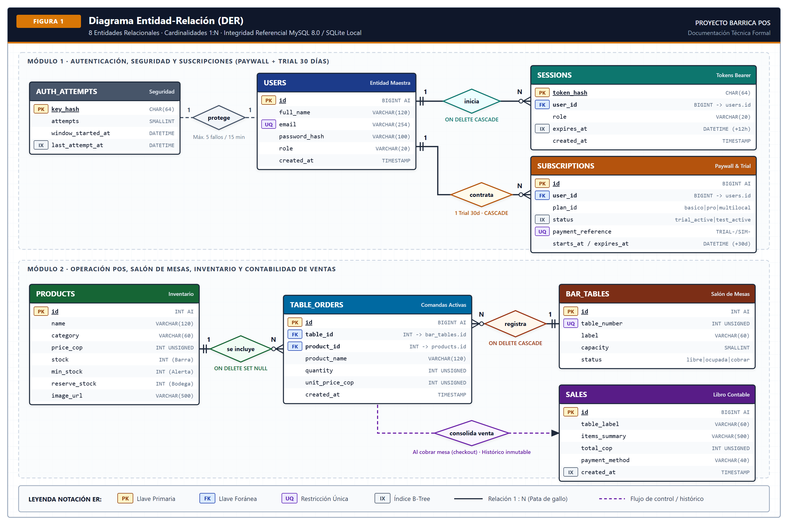

### 1.1 Mapa Dinámico del Diagrama Entidad-Relación (Relaciones y Cardinalidades)

| Entidad Origen (Lado `1`) | Llave Primaria (`PK`) | cardinalidad | Relación Semántica | Entidad Destino (Lado `N`) | Llave Foránea (`FK`) | Regla de Integridad |
| :--- | :--- | :---: | :---: | :--- | :--- | :--- |
| **`USERS`** *(Usuarios)* | 🔑 `users.id` | **`1 ───► N`** | **`inicia`** *(1 usuario inicia N sesiones)* | **`SESSIONS`** *(Sesiones)* | 🔗 `sessions.user_id` | `ON DELETE CASCADE` |
| **`USERS`** *(Usuarios)* | 🔑 `users.id` | **`1 ───► N`** | **`contrata`** *(1 usuario activa plan o 1 trial 30d)* | **`SUBSCRIPTIONS`** *(Planes)* | 🔗 `subscriptions.user_id` | `ON DELETE CASCADE` |
| **`BAR_TABLES`** *(Mesas)* | 🔑 `bar_tables.id` | **`1 ───► N`** | **`registra_consumo`** *(1 mesa tiene N pedidos)* | **`TABLE_ORDERS`** *(Comandas)* | 🔗 `table_orders.table_id` | `ON DELETE CASCADE` |
| **`PRODUCTS`** *(Productos)* | 🔑 `products.id` | **`1 ───► N`** | **`se_incluye_en`** *(1 producto está en N comandas)* | **`TABLE_ORDERS`** *(Comandas)* | 🔗 `table_orders.product_id` | `ON DELETE SET NULL` |
| **`AUTH_ATTEMPTS`** *(Seguridad)* | 🔑 `auth_attempts.key_hash` | **`1 : 1`** | **`protege_login`** *(Hash SHA-256 `email:IP`)* | *Control Rate-Limiting* | — *(Entidad autónoma)* | Máx. 5 intentos / 15 min |
| **`SALES`** *(Ventas Cerradas)* | 🔑 `sales.id` | **`Histórico`** | **`consolida_cobro`** *(Libro contable inmutable)* | *Arqueo y Turnos* | — *(Entidad histórica)* | Indexada por `created_at` |

### 1.2 Vista Comparativa de las 8 Entidades del DER

| # | Entidad | Clave Primaria (`PK`) | Claves Foráneas (`FK`) | Restricciones (`UQ` / `IDX`) | Atributos Principales | Función en el Sistema |
| :---: | :--- | :--- | :--- | :--- | :--- | :--- |
| **1** | **`USERS`** | 🔑 `id` (`BIGINT`) | — | ✦ `email` (`UNIQUE`) | `full_name`, `email`, `password_hash`, `role`, `created_at` | Cuentas de `administrador` (vitalicio) y `vendedor`. |
| **2** | **`SESSIONS`** | 🔑 `token_hash` (`CHAR(64)`) | 🔗 `user_id → USERS.id` | ⚡ `user_id`, `expires_at` | `token_hash`, `user_id`, `role`, `expires_at`, `created_at` | Tokens Bearer por pestaña con vigencia de 12 horas. |
| **3** | **`SUBSCRIPTIONS`** | 🔑 `id` (`BIGINT`) | 🔗 `user_id → USERS.id` | ✦ `payment_reference` (`UQ`) | `plan_id`, `status`, `payment_reference`, `starts_at`, `expires_at` | Control de paywall POS, pagos `SIM-...` y 1 `TRIAL-...` (30 días) por cuenta. |
| **4** | **`AUTH_ATTEMPTS`** | 🔑 `key_hash` (`CHAR(64)`) | — | ⚡ `last_attempt_at` | `attempts`, `window_started_at`, `last_attempt_at` | Bloqueo temporal (HTTP 429) tras 5 intentos fallidos en 15 min. |
| **5** | **`PRODUCTS`** | 🔑 `id` (`INT`) | — | — | `name`, `category`, `price_cop`, `stock`, `min_stock`, `reserve_stock`, `image_url` | Carta de licores, stock en barra, bodega de reserva y fotos. |
| **6** | **`BAR_TABLES`** | 🔑 `id` (`INT`) | — | ✦ `table_number` (`UQ`) | `table_number`, `label`, `capacity`, `status` | Mapa del salón (`libre`, `ocupada`, `por_cobrar`). |
| **7** | **`TABLE_ORDERS`** | 🔑 `id` (`BIGINT`) | 🔗 `table_id`, 🔗 `product_id` | ⚡ `table_id` | `product_name`, `quantity`, `unit_price_cop`, `created_at` | Líneas de consumo activas por mesa con descuento de stock. |
| **8** | **`SALES`** | 🔑 `id` (`BIGINT`) | — | ⚡ `created_at` | `table_label`, `items_summary`, `total_cop`, `payment_method`, `created_at` | Registro contable de cuentas cobradas y base del cierre de turno. |

<details>
<summary><b>📊 Expandir / Contraer Código Mermaid Editable del DER</b></summary>

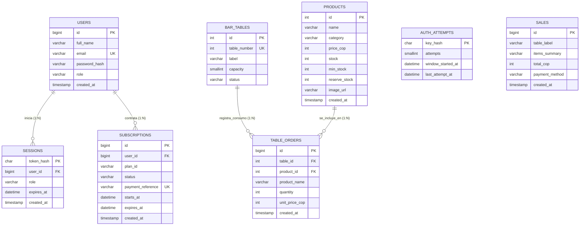

</details>

---

## 2. Modelo Relacional (MR)

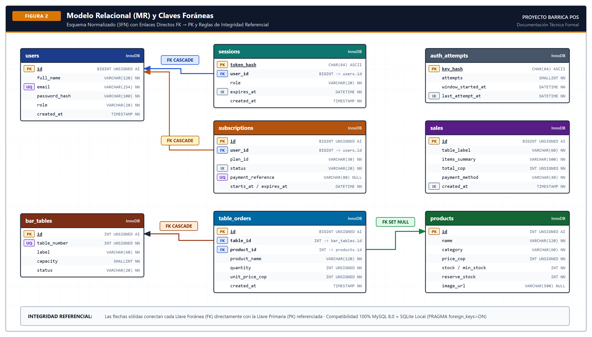

### 2.1 Esquema Relacional Formal en Tabla Dinámica

| N.º | Tabla Relacional | Esquema Formal de Columnas, Llaves Primarias (`PK`), Foráneas (`FK`) y Unicidad (`UQ`) | Motor / Colación |
| :---: | :--- | :--- | :---: |
| **1** | **`users`** | (**id** `PK`, `full_name`, `email` `UQ`, `password_hash`, `role`, `created_at`) | `InnoDB` / `utf8mb4` |
| **2** | **`sessions`** | (**token_hash** `PK`, *user_id* `FK → users.id ON DELETE CASCADE`, `role`, `expires_at`, `created_at`) | `InnoDB` / `ascii_bin` |
| **3** | **`subscriptions`** | (**id** `PK`, *user_id* `FK → users.id ON DELETE CASCADE`, `plan_id`, `status`, `payment_reference` `UQ`, `starts_at`, `expires_at`, `created_at`) | `InnoDB` / `utf8mb4` |
| **4** | **`auth_attempts`** | (**key_hash** `PK`, `attempts`, `window_started_at`, `last_attempt_at`) | `InnoDB` / `ascii_bin` |
| **5** | **`products`** | (**id** `PK`, `name`, `category`, `price_cop`, `stock`, `min_stock`, `reserve_stock`, `image_url`, `created_at`) | `InnoDB` / `utf8mb4` |
| **6** | **`bar_tables`** | (**id** `PK`, `table_number` `UQ`, `label`, `capacity`, `status`) | `InnoDB` / `utf8mb4` |
| **7** | **`table_orders`** | (**id** `PK`, *table_id* `FK → bar_tables.id ON DELETE CASCADE`, *product_id* `FK → products.id ON DELETE SET NULL`, `product_name`, `quantity`, `unit_price_cop`, `created_at`) | `InnoDB` / `utf8mb4` |
| **8** | **`sales`** | (**id** `PK`, `table_label`, `items_summary`, `total_cop`, `payment_method`, `created_at`) | `InnoDB` / `utf8mb4` |

### 2.2 Matriz de Integridad Referencial y Restricciones

| Tabla Origen | Columna Foránea (`FK`) | Vínculo Relacional | Tabla Destino (`PK`) | Regla `ON DELETE` | Propósito en el Negocio |
| :--- | :--- | :---: | :--- | :---: | :--- |
| **`sessions`** | `user_id` | 🔗 `FK` ──► 🔑 `PK` | `users(id)` | `CASCADE` | Revoca automáticamente todas las sesiones si se elimina el usuario. |
| **`subscriptions`** | `user_id` | 🔗 `FK` ──► 🔑 `PK` | `users(id)` | `CASCADE` | Elimina el historial de planes y prueba gratuita asociados si se borra la cuenta titular. |
| **`table_orders`** | `table_id` | 🔗 `FK` ──► 🔑 `PK` | `bar_tables(id)` | `CASCADE` | Limpia las órdenes abiertas si una mesa es eliminada del salón. |
| **`table_orders`** | `product_id` | 🔗 `FK` ──► 🔑 `PK` | `products(id)` | `SET NULL` | Mantiene el ítem en la cuenta abierta usando `product_name` y `unit_price_cop` aunque el producto se borre del catálogo. |

---

## 3. Diccionario de Datos

<details open>
<summary><b>🗂️ 3.1 Tabla <code>users</code> — Usuarios del sistema y sus roles (Click para expandir / contraer)</b></summary>

| # | Campo | Tipo de Dato | Nulabilidad | Clave / Índice | Por Defecto | Descripción Funcional |
| :---: | :--- | :--- | :---: | :---: | :---: | :--- |
| **1** | **`id`** | `BIGINT UNSIGNED` | 🟢 `NOT NULL` | 🔑 `PK`, `AUTO_INCREMENT` | — | Identificador único autoincremental del usuario. |
| **2** | **`full_name`** | `VARCHAR(120)` | 🟢 `NOT NULL` | — | — | Nombre completo del integrante (validado sin dígitos numéricos). |
| **3** | **`email`** | `VARCHAR(254)` | 🟢 `NOT NULL` | ✦ `UNIQUE` (`uq_users_email`) | — | Correo electrónico único normalizado en minúsculas. |
| **4** | **`password_hash`** | `VARCHAR(100)` | 🟢 `NOT NULL` | — | — | Hash criptográfico `bcrypt` (12 rondas de costo). |
| **5** | **`role`** | `VARCHAR(20)` | 🟢 `NOT NULL` | — | `'vendedor'` | Rol de autorización: `'administrador'` (acceso vitalicio) o `'vendedor'`. |
| **6** | **`created_at`** | `TIMESTAMP` | 🟢 `NOT NULL` | — | `CURRENT_TIMESTAMP` | Fecha y hora UTC de creación de la cuenta. |

</details>

<details open>
<summary><b>🗂️ 3.2 Tabla <code>sessions</code> — Sesiones activas por pestaña e historial de accesos (Click para expandir / contraer)</b></summary>

| # | Campo | Tipo de Dato | Nulabilidad | Clave / Índice | Por Defecto | Descripción Funcional |
| :---: | :--- | :--- | :---: | :---: | :---: | :--- |
| **1** | **`token_hash`** | `CHAR(64) ASCII` | 🟢 `NOT NULL` | 🔑 `PK` | — | Hash SHA-256 en ASCII del token de sesión aleatorio emitido al cliente. |
| **2** | **`user_id`** | `BIGINT UNSIGNED` | 🟢 `NOT NULL` | 🔗 `FK`, ⚡ `INDEX` | — | Referencia al propietario de la sesión en `users(id)`. |
| **3** | **`role`** | `VARCHAR(20)` | 🟢 `NOT NULL` | — | `'vendedor'` | Rol efectivo con el que se autenticó la sesión. |
| **4** | **`expires_at`** | `DATETIME` | 🟢 `NOT NULL` | ⚡ `INDEX` | `+12 HORAS` | Fecha y hora UTC de expiración del token (12 horas operativas). |
| **5** | **`created_at`** | `TIMESTAMP` | 🟢 `NOT NULL` | — | `CURRENT_TIMESTAMP` | Fecha y hora UTC del inicio de sesión. |

</details>

<details open>
<summary><b>🗂️ 3.3 Tabla <code>subscriptions</code> — Planes pagos, prueba gratuita única de 30 días y paywall POS (Click para expandir / contraer)</b></summary>

| # | Campo | Tipo de Dato | Nulabilidad | Clave / Índice | Por Defecto | Descripción Funcional |
| :---: | :--- | :--- | :---: | :---: | :---: | :--- |
| **1** | **`id`** | `BIGINT UNSIGNED` | 🟢 `NOT NULL` | 🔑 `PK`, `AUTO_INCREMENT` | — | Identificador único de la suscripción. |
| **2** | **`user_id`** | `BIGINT UNSIGNED` | 🟢 `NOT NULL` | 🔗 `FK`, ⚡ `INDEX` | — | Usuario titular de la suscripción (`users.id`). |
| **3** | **`plan_id`** | `VARCHAR(30)` | 🟢 `NOT NULL` | — | — | Código del plan contratado (`basico`, `pro`, `multilocal`). |
| **4** | **`status`** | `VARCHAR(20)` | 🟢 `NOT NULL` | ⚡ `INDEX` | `'pending'` | Estado de vigencia (`active`, `test_active`, `trial_active`, `expired`). |
| **5** | **`payment_reference`** | `VARCHAR(80)` | ⚪ `NULLABLE` | ✦ `UNIQUE` | `NULL` | Folio único del recibo (`SIM-AAAAMMDD-XXXXXX` o `TRIAL-AAAAMMDD-XXXXXX`). |
| **6** | **`starts_at`** | `DATETIME` | 🟢 `NOT NULL` | — | `UTC_TIMESTAMP()` | Fecha y hora UTC de inicio de cobertura del plan. |
| **7** | **`expires_at`** | `DATETIME` | 🟢 `NOT NULL` | ⚡ `INDEX` | `+30 DÍAS` | Fecha y hora UTC de corte/expiración del plan (30 días). |
| **8** | **`created_at`** | `TIMESTAMP` | 🟢 `NOT NULL` | — | `CURRENT_TIMESTAMP` | Marca temporal de creación del registro. |

#### Tabla Comparativa de Planes, Prueba Gratuita de 30 Días (`1x Cuenta`) y Rol Administrador

| Plan / Modalidad | Código (`plan_id`) | Precio Mensual (USD / COP) | Opción Prueba Gratuita 30 Días | Estado en BD (`status`) | Funciones Habilitadas en el POS |
| :--- | :---: | :---: | :---: | :---: | :--- |
| **Plan Básico** | `basico` | **`$29 USD`** / `$116.000 COP` | 🎁 **`$0,00` hoy** (1 vez por cuenta) | `test_active` / `trial_active` | 1 local · hasta 10 mesas · comandas y cuentas · inventario básico · soporte correo |
| **Plan Pro** *(Recomendado)* | `pro` | **`$59 USD`** / `$236.000 COP` | 🎁 **`$0,00` hoy** (1 vez por cuenta) | `test_active` / `trial_active` | 1 local · mesas ilimitadas · recetas y alertas · turnos y roles · reportes y chat |
| **Plan Multi-local** | `multilocal` | **`$129 USD`** / `$516.000 COP` | 🎁 **`$0,00` hoy** (1 vez por cuenta) | `test_active` / `trial_active` | Hasta 5 locales · reportes consolidados · inventario entre sedes · gerente VIP |
| **◈ Administrador Vitalicio** | `multilocal` | **`$0 USD`** *(Sin cobro)* | **Vitalicio permanente** | `lifetime` | Acceso total automático para `admin@gmail.com` sin pasar por checkout |

</details>

<details open>
<summary><b>🗂️ 3.4 Tabla <code>auth_attempts</code> — Protección contra ataques de fuerza bruta (Click para expandir / contraer)</b></summary>

| # | Campo | Tipo de Dato | Nulabilidad | Clave / Índice | Por Defecto | Descripción Funcional |
| :---: | :--- | :--- | :---: | :---: | :---: | :--- |
| **1** | **`key_hash`** | `CHAR(64) ASCII` | 🟢 `NOT NULL` | 🔑 `PK` | — | Hash SHA-256 del par `email:ip_cliente`. |
| **2** | **`attempts`** | `SMALLINT UNSIGNED` | 🟢 `NOT NULL` | — | `0` | Contador de intentos fallidos dentro de la ventana de 15 minutos (máx. 5). |
| **3** | **`window_started_at`** | `DATETIME` | 🟢 `NOT NULL` | — | `UTC_TIMESTAMP()` | Inicio de la ventana temporal de evaluación. |
| **4** | **`last_attempt_at`** | `DATETIME` | 🟢 `NOT NULL` | ⚡ `INDEX` | `UTC_TIMESTAMP()` | Fecha y hora UTC del último intento fallido registrado. |

</details>

<details open>
<summary><b>🗂️ 3.5 Tabla <code>products</code> — Inventario de licores, carta y bodega de reserva (Click para expandir / contraer)</b></summary>

| # | Campo | Tipo de Dato | Nulabilidad | Clave / Índice | Por Defecto | Descripción Funcional |
| :---: | :--- | :--- | :---: | :---: | :---: | :--- |
| **1** | **`id`** | `INT UNSIGNED` | 🟢 `NOT NULL` | 🔑 `PK`, `AUTO_INCREMENT` | — | Identificador único del producto en la carta. |
| **2** | **`name`** | `VARCHAR(120)` | 🟢 `NOT NULL` | — | — | Nombre comercial de la bebida, botella, cóctel o comida. |
| **3** | **`category`** | `VARCHAR(60)` | 🟢 `NOT NULL` | — | `'Licores'` | Categoría (`Licores`, `Cócteles`, `Cervezas`, `Comida`, `Sin alcohol`). |
| **4** | **`price_cop`** | `INT UNSIGNED` | 🟢 `NOT NULL` | — | — | Precio unitario de venta en pesos colombianos (COP). |
| **5** | **`stock`** | `INT` | 🟢 `NOT NULL` | — | `0` | Unidades disponibles para venta inmediata en barra. |
| **6** | **`min_stock`** | `INT` | 🟢 `NOT NULL` | — | `5` | Punto de reorden para encender alerta visual de agotamiento. |
| **7** | **`reserve_stock`** | `INT` | 🟢 `NOT NULL` | — | `0` | Unidades almacenadas en la bodega interna de reserva. |
| **8** | **`image_url`** | `VARCHAR(500)` | ⚪ `NULLABLE` | — | `NULL` | Ruta estática o URL de la fotografía optimizada del producto. |
| **9** | **`created_at`** | `TIMESTAMP` | 🟢 `NOT NULL` | — | `CURRENT_TIMESTAMP` | Fecha y hora UTC de incorporación al catálogo. |

#### Catálogo Semilla de Productos en `products` (Precios, Stock, Alertas y Recetas)

| ID | Nombre del Producto (`name`) | Categoría (`category`) | Precio Unitario (`price_cop`) | Stock Barra (`stock`) | Stock Mínimo (`min_stock`) | Estado de Stock | Receta / Estándar de Preparación en Barra |
| :---: | :--- | :---: | :---: | :---: | :---: | :---: | :--- |
| **`1`** | **Negroni** | `Cócteles` | **`$28.000 COP`** | `24 uds` | `5 uds` | 🟢 **Normal** | 30ml Gin Tanqueray + 30ml Campari + 30ml Vermut Rosso + Piel de naranja |
| **`2`** | **Old Fashioned** | `Cócteles` | **`$30.000 COP`** | `20 uds` | `5 uds` | 🟢 **Normal** | 60ml Bourbon + 1 Terrón azúcar + 3 dash Angostura + Hielo roca |
| **`3`** | **Margarita Artesanal** | `Cócteles` | **`$26.000 COP`** | `18 uds` | `5 uds` | 🟢 **Normal** | 50ml Tequila Blanco + 25ml Triple Sec + 25ml Lima fresca + Sal |
| **`4`** | **Cerveza Club Colombia** | `Cervezas` | **`$9.000 COP`** | `48 uds` | `12 uds` | 🟢 **Normal** | Botella 330ml fría (3°C) + Vaso cervecero escarchado |
| **`5`** | **Cerveza Artesanal IPA** | `Cervezas` | **`$15.000 COP`** | `30 uds` | `8 uds` | 🟢 **Normal** | Pinta 473ml barril artesanal + Posavasos Barrica |
| **`6`** | **Botella Ginebra Tanqueray** | `Licores` | **`$165.000 COP`** | `3 uds` | `4 uds` | 🔴 **Alerta Stock Bajo** | Botella 700ml + 4 Tónicas Premium + Botánicos cítricos |
| **`7`** | **Botella Aguardiente Antioqueño** | `Licores` | **`$85.000 COP`** | `10 uds` | `4 uds` | 🟢 **Normal** | Botella 750ml + Copas cristalería + Limón |
| **`8`** | **Tabla de Quesos y Madurados** | `Comida` | **`$42.000 COP`** | `12 uds` | `3 uds` | 🟢 **Normal** | 120g Queso Paipa + 80g Prosciutto + Aceitunas + Pan masa madre |

</details>

<details open>
<summary><b>🗂️ 3.6 Tabla <code>bar_tables</code> — Mesas y puestos de barra del salón (Click para expandir / contraer)</b></summary>

| # | Campo | Tipo de Dato | Nulabilidad | Clave / Índice | Por Defecto | Descripción Funcional |
| :---: | :--- | :--- | :---: | :---: | :---: | :--- |
| **1** | **`id`** | `INT UNSIGNED` | 🟢 `NOT NULL` | 🔑 `PK`, `AUTO_INCREMENT` | — | Identificador interno de la mesa. |
| **2** | **`table_number`** | `INT UNSIGNED` | 🟢 `NOT NULL` | ✦ `UNIQUE` (`uq_bar_tables_number`) | — | Número único visible de la mesa o puesto en el mapa del local. |
| **3** | **`label`** | `VARCHAR(60)` | 🟢 `NOT NULL` | — | — | Nombre descriptivo y zona (ej. `Mesa 4 · Terraza`, `Mesa 6 · VIP`). |
| **4** | **`capacity`** | `SMALLINT UNSIGNED` | 🟢 `NOT NULL` | — | `4` | Capacidad de personas sentadas en la mesa. |
| **5** | **`status`** | `VARCHAR(20)` | 🟢 `NOT NULL` | — | `'libre'` | Estado operativo en tiempo real (`libre`, `ocupada`, `por_cobrar`). |

#### Distribución Semilla de las 8 Mesas Operativas (`bar_tables`)

| ID | N.º Mesa (`table_number`) | Nombre y Zona (`label`) | Capacidad (`capacity`) | Estado Inicial (`status`) | Ubicación en el Local |
| :---: | :---: | :--- | :---: | :---: | :--- |
| `1` | **`Mesa 01`** | `Mesa 1 · Salón` | `4 puestos` | 🟢 `libre` | Salón Principal |
| `2` | **`Mesa 02`** | `Mesa 2 · Salón` | `4 puestos` | 🟢 `libre` | Salón Principal |
| `3` | **`Mesa 03`** | `Mesa 3 · Ventana` | `2 puestos` | 🟢 `libre` | Zona Ventana |
| `4` | **`Mesa 04`** | `Mesa 4 · Terraza` | `6 puestos` | 🟢 `libre` | Terraza Exterior |
| `5` | **`Mesa 05`** | `Mesa 5 · Terraza` | `4 puestos` | 🟢 `libre` | Terraza Exterior |
| `6` | **`Mesa 06`** | `Mesa 6 · VIP` | `8 puestos` | 🟢 `libre` | Reservado VIP / Cava |
| `7` | **`Barra 07`** | `Barra 1 · Principal` | `2 puestos` | 🟢 `libre` | Barra Central |
| `8` | **`Barra 08`** | `Barra 2 · Principal` | `2 puestos` | 🟢 `libre` | Barra Central |

</details>

<details open>
<summary><b>🗂️ 3.7 Tabla <code>table_orders</code> — Comandas y consumos activos por mesa (Click para expandir / contraer)</b></summary>

| # | Campo | Tipo de Dato | Nulabilidad | Clave / Índice | Por Defecto | Descripción Funcional |
| :---: | :--- | :--- | :---: | :---: | :---: | :--- |
| **1** | **`id`** | `BIGINT UNSIGNED` | 🟢 `NOT NULL` | 🔑 `PK`, `AUTO_INCREMENT` | — | Identificador único de la línea de pedido. |
| **2** | **`table_id`** | `INT UNSIGNED` | 🟢 `NOT NULL` | 🔗 `FK`, ⚡ `INDEX` | — | Referencia a la mesa activa (`bar_tables.id`). |
| **3** | **`product_id`** | `INT UNSIGNED` | ⚪ `NULLABLE` | 🔗 `FK` | `NULL` | Referencia al producto descontado (`products.id`). |
| **4** | **`product_name`** | `VARCHAR(120)` | 🟢 `NOT NULL` | — | — | Nombre congelado del producto en el instante de la comanda. |
| **5** | **`quantity`** | `INT UNSIGNED` | 🟢 `NOT NULL` | — | `1` | Cantidad de unidades servidas en esa línea. |
| **6** | **`unit_price_cop`** | `INT UNSIGNED` | 🟢 `NOT NULL` | — | — | Precio unitario en COP congelado al tomar el pedido. |
| **7** | **`created_at`** | `TIMESTAMP` | 🟢 `NOT NULL` | — | `CURRENT_TIMESTAMP` | Hora exacta de solicitud del consumo. |

</details>

<details open>
<summary><b>🗂️ 3.8 Tabla <code>sales</code> — Historial contable de ventas cobradas (Click para expandir / contraer)</b></summary>

| # | Campo | Tipo de Dato | Nulabilidad | Clave / Índice | Por Defecto | Descripción Funcional |
| :---: | :--- | :--- | :---: | :---: | :---: | :--- |
| **1** | **`id`** | `BIGINT UNSIGNED` | 🟢 `NOT NULL` | 🔑 `PK`, `AUTO_INCREMENT` | — | Consecutivo único de la venta cerrada. |
| **2** | **`table_label`** | `VARCHAR(60)` | 🟢 `NOT NULL` | — | — | Etiqueta de la mesa donde se efectuó el consumo. |
| **3** | **`items_summary`** | `VARCHAR(500)` | 🟢 `NOT NULL` | — | — | Resumen textual de los productos y cantidades facturadas. |
| **4** | **`total_cop`** | `INT UNSIGNED` | 🟢 `NOT NULL` | — | — | Monto total pagado en pesos colombianos (COP). |
| **5** | **`payment_method`** | `VARCHAR(40)` | 🟢 `NOT NULL` | — | `'Efectivo'` | Medio de pago (`Efectivo`, `Tarjeta`, `Transferencia / Nequi`). |
| **6** | **`created_at`** | `TIMESTAMP` | 🟢 `NOT NULL` | ⚡ `INDEX` | `CURRENT_TIMESTAMP` | Fecha y hora UTC del cierre de cuenta. |

</details>

### 3.9 Entidades Operativas en Memoria / Almacenamiento JSON (`shifts`, `invoices`, `clients`)

| Entidad Operativa | Folio / Identificador | Campos Estructura JSON | Rol con Acceso a Historial |
| :--- | :---: | :--- | :---: |
| **Turno de Caja (`shift`)** | `CIERRE-TURNO-XXXXX` | `id`, `folio`, `opened_at`, `closed_at`, `manager` (`name`, `document_type`, `document_number`, `phone`, `position`), `initial_cash_cop`, `products_sold`, `payment_breakdown`, `total_sales_cop`, `expected_cash_in_box_cop` | Apertura/Cierre: Todos · Historial: **Solo Admin** |
| **Factura Fantasma (`invoice`)** | `FAC-FANTASMA-XXXXX` | `id`, `folio`, `date`, `table_label`, `client`, `client_info`, `items`, `detail`, `payment_method`, `cash_received`, `cash_change`, `total`, `cashier`, `shift_id` | Emisión al cobrar: Todos · Auditoría: **Solo Admin** |
| **Cliente CRM (`client`)** | `cli-XXXXX` | `id`, `name`, `email`, `phone`, `address`, `city`, `country`, `created_at` (Clasificación imprimible por país) | **Administrador y Vendedor** |

---

## 4. Diagramas UML

### 4.1 Diagrama de Casos de Uso

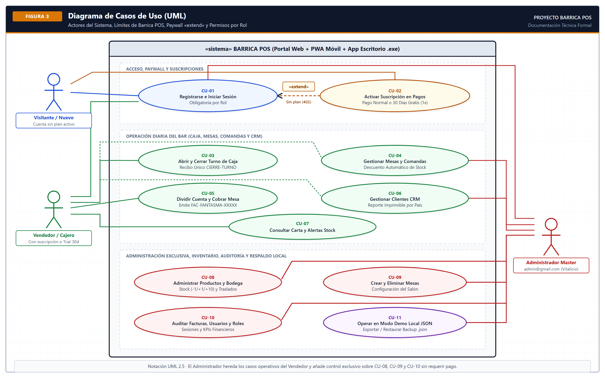

#### Matriz Dinámica del Diagrama de Casos de Uso por Actor

| Código | Caso de Uso del Sistema Barrica POS | Visitante / Cuenta Nueva | Vendedor / Cajero POS | Administrador (`admin@gmail.com`) | Endpoint / Módulo Asociado |
| :---: | :--- | :---: | :---: | :---: | :--- |
| **`CU-01`** | Registrarse e iniciar sesión obligatoria por rol | 🟢 **SÍ** | 🟢 **SÍ** | 🟢 **SÍ (Vitalicio)** | `POST /api/auth/register` · `POST /api/auth/login` |
| **`CU-02`** | Activar suscripción en Pagos (**Pago Normal** o **30 Días Gratis 1x cuenta**) | 🟢 **SÍ (Obligatorio)** | 🟢 **SÍ** | ⚪ *No requiere (Vitalicio)* | `POST /api/payments/simulate` · `GET /api/auth/subscription` |
| **`CU-03`** | Abrir y cerrar turno de caja con recibo único consolidado | 🔴 No | 🟢 **SÍ** | 🟢 **SÍ** | `POST /api/bar/shifts/open` · `POST /api/bar/shifts/close` |
| **`CU-04`** | Gestionar estado de mesas y tomar pedidos con descuento de stock | 🔴 No | 🟢 **SÍ** | 🟢 **SÍ** | `POST /api/bar/tables/<id>/orders` |
| **`CU-05`** | Dividir cuenta entre N personas, calcular cambio y cobrar mesa | 🔴 No | 🟢 **SÍ** | 🟢 **SÍ** | `POST /api/bar/tables/<id>/checkout` |
| **`CU-06`** | Registrar clientes en CRM por país y asociar a cobro | 🔴 No | 🟢 **SÍ** | 🟢 **SÍ** | Módulo `#tab-clientes` (`bar_app.html`) |
| **`CU-07`** | Consultar carta de productos y alertas de inventario en vivo | 🔴 No | 🟡 **Solo Lectura** | 🟢 **Control Total** | `GET /api/bar/dashboard` |
| **`CU-08`** | Administrar productos, stock (`-1/+1/+10`) y traslados de bodega de reserva | 🔴 No | 🔴 No (`HTTP 403`) | 🟢 **Exclusivo Admin** | `POST /api/bar/products` · `.../stock` · `.../reserve` |
| **`CU-09`** | Crear y eliminar mesas del salón | 🔴 No | 🔴 No (`HTTP 403`) | 🟢 **Exclusivo Admin** | `POST /api/bar/tables` · `DELETE /api/bar/tables/<id>` |
| **`CU-10`** | Auditar facturas fantasma (`FAC-FANTASMA`), usuarios, sesiones, KPIs y roles | 🔴 No | 🔴 No (`HTTP 403`) | 🟢 **Exclusivo Admin** | `GET /api/bar/invoices` · `POST /api/bar/users/<id>/role` |
| **`CU-11`** | Operar en Modo Demo Local JSON con exportación/restauración `.json` | 🟢 **SÍ** | 🟢 **SÍ** | 🟢 **SÍ** | `iniciar_demo_local_json.bat` · `/bar_app?mode=local` |

<details>
<summary><b>📊 Expandir / Contraer Código Mermaid Editable de Casos de Uso</b></summary>

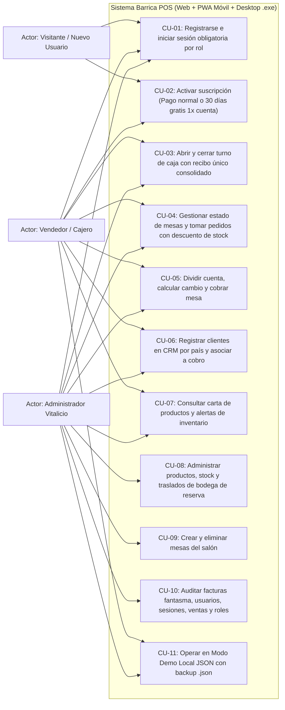

</details>

---

### 4.2 Diagrama de Clases

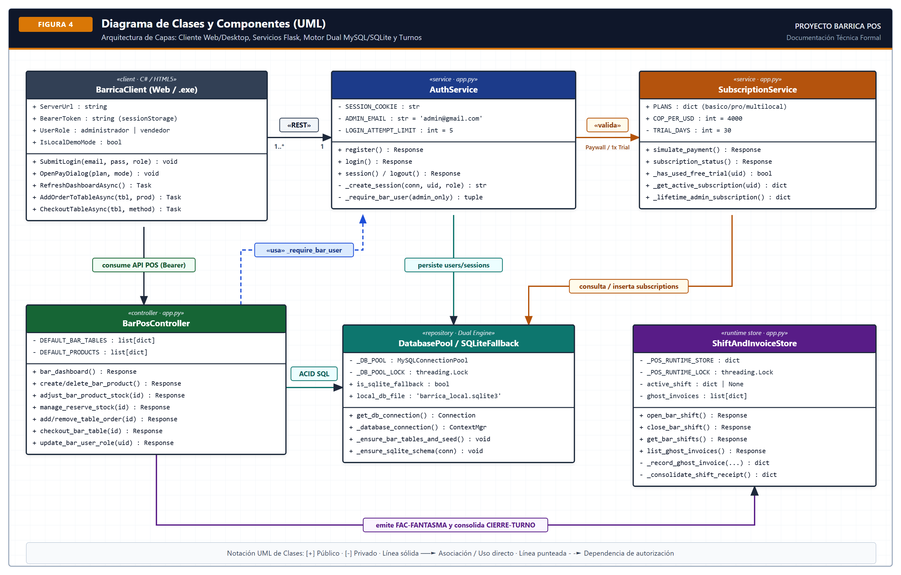

#### Tabla Dinámica de Clases, Atributos, Métodos y Relaciones UML

| Clase / Componente | Capa | Atributos Privados / Públicos (`-` / `+`) | Métodos Principales (`+` / `-`) | Relaciones UML con Otras Clases |
| :--- | :---: | :--- | :--- | :--- |
| **`DatabasePool` / `_SQLiteFallbackConnection`** | Persistencia (`app.py`) | `- _DB_POOL: MySQLConnectionPool`<br>`- _DB_POOL_LOCK: Lock`<br>`+ is_sqlite_fallback: bool` | `+ get_db_connection()`<br>`+ _database_connection()`<br>`+ _ensure_bar_tables_and_seed()`<br>`+ _ensure_sqlite_schema()` | Provee conexiones transaccionales ACID a `AuthService`, `SubscriptionService` y `BarPosController`. |
| **`AuthService`** | Seguridad (`app.py`) | `- SESSION_COOKIE: str`<br>`- _ADMIN_DEFAULT_EMAIL: str`<br>`- LOGIN_ATTEMPT_LIMIT: int = 5` | `+ register() Response`<br>`+ login() Response`<br>`+ session() / logout() Response`<br>`- _require_bar_user(admin_only)` | Usa `DatabasePool` y delega validación de acceso POS a `SubscriptionService`. |
| **`SubscriptionService`** | Paywall y Pagos (`app.py`) | `+ PLANS: dict (basico/pro/multilocal)`<br>`+ COP_PER_USD: int = 4000` | `+ simulate_payment() Response`<br>`+ subscription_status() Response`<br>`+ _has_used_free_trial(user_id) bool`<br>`+ _get_active_subscription(user_id)`<br>`+ _lifetime_admin_subscription()` | Verifica límite de **1 prueba gratuita de 30 días por cuenta** (`409` en reintento) y acceso vitalicio de `admin@gmail.com`. |
| **`BarPosController`** | Operación POS (`app.py`) | `- DEFAULT_BAR_TABLES: list`<br>`- DEFAULT_PRODUCTS: list` | `+ bar_dashboard()`<br>`+ create/delete_bar_product()`<br>`+ adjust_bar_product_stock()`<br>`+ manage_reserve_stock()`<br>`+ add/remove_table_order()`<br>`+ checkout_bar_table()`<br>`+ update_bar_user_role()` | Protegido por `AuthService._require_bar_user()`; al cobrar mesa invoca a `ShiftAndInvoiceStore`. |
| **`ShiftAndInvoiceStore`** | Turnos y Facturas (`app.py`) | `- _POS_RUNTIME_STORE: dict`<br>`- _POS_RUNTIME_LOCK: Lock` | `+ open_bar_shift()`<br>`+ close_bar_shift()`<br>`+ get_bar_shifts()`<br>`+ list/create_ghost_invoice()`<br>`- _consolidate_shift_receipt()` | Acumula ventas del turno abierto y emite `FAC-FANTASMA-XXXXX` y `CIERRE-TURNO-XXXXX`. |
| **`SessionContext` / `LoginForm` / `MainForm`** | Cliente Desktop (`BarricaDesktop.cs`) | `+ ServerUrl: string`<br>`+ Token / UserRole: string`<br>`+ IsAdmin: bool` | `+ SubmitAuth()`<br>`+ RefreshDashboardAsync()`<br>`+ AddOrderToTableAsync()`<br>`+ CheckoutTableAsync()` | Consume `BarPosController` y `AuthService` vía HTTP REST JSON con token `Bearer`. |

<details>
<summary><b>📊 Expandir / Contraer Código Mermaid Editable del Diagrama de Clases</b></summary>

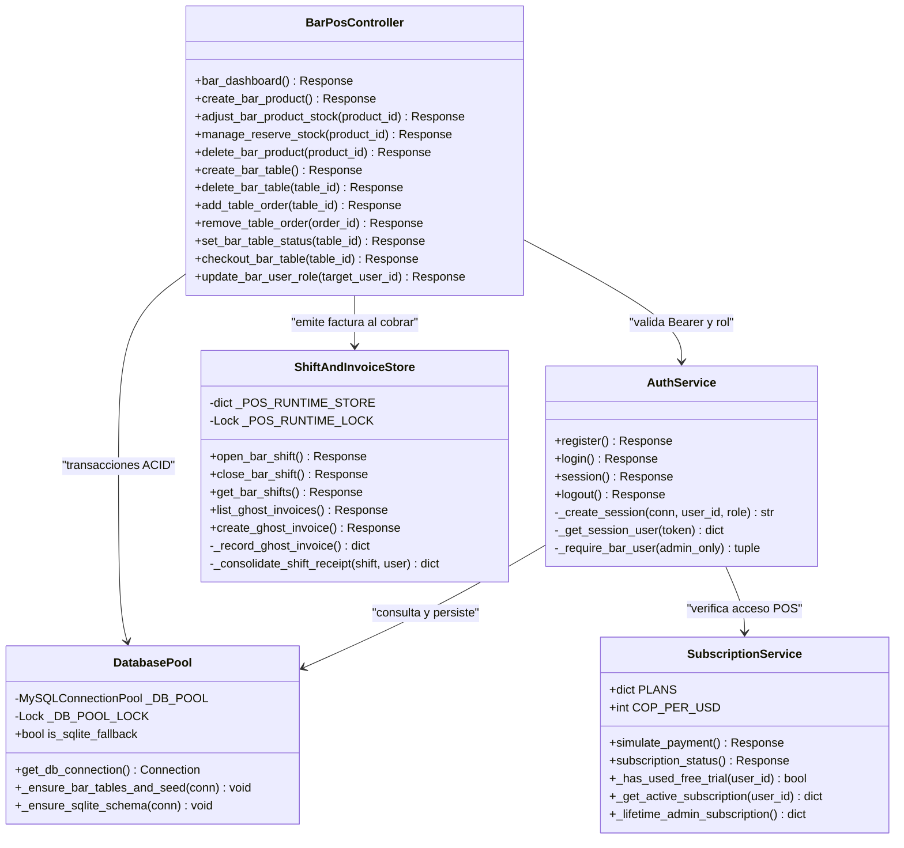

</details>

---

### 4.3 Diagramas de Actividades

#### 4.3.1 Flujo de Login Obligatorio, Paywall de Cuentas Nuevas, Prueba Gratuita de 30 Días (`1x Cuenta`) y Admin Vitalicio

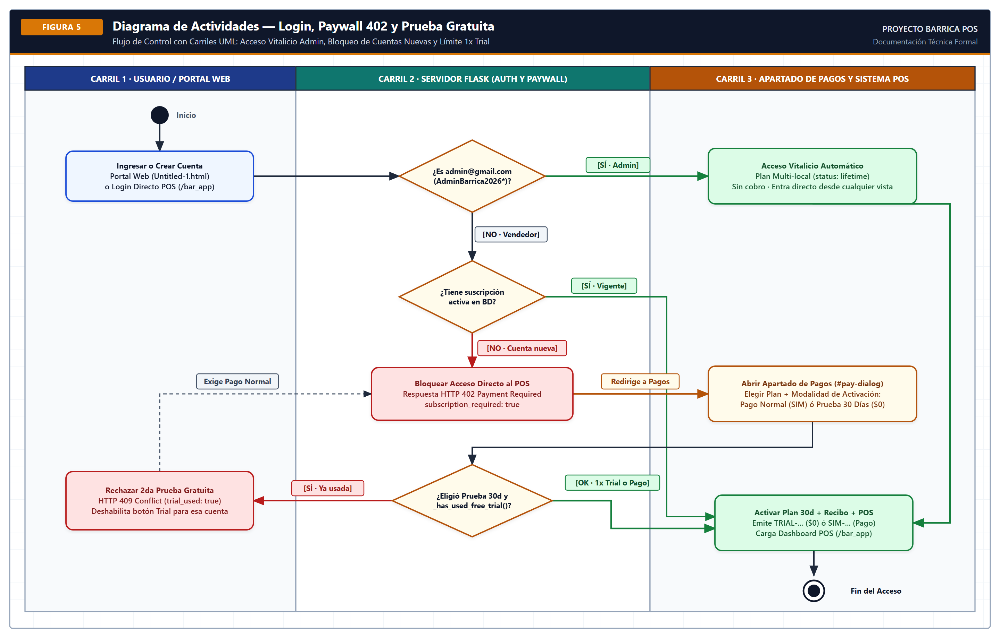

| Paso | Nodo / Tipo UML | Actividad / Decisión en el Sistema | Condición / Transición | Resultado /Siguiente Paso |
| :---: | :---: | :--- | :--- | :--- |
| **1** | `● Inicio` | Usuario abre Portal Web (`Untitled-1.html`) o Sistema POS (`/bar_app`) | Ingresa credenciales o crea cuenta nueva | Pasa al Nodo **2** |
| **2** | `◇ Decisión` | **¿Son credenciales de `admin@gmail.com` (`AdminBarrica2026*`)?** | **SÍ (Administrador)** | Otorga plan **`Multi-local` Vitalicio** automático sin pedir pago → Salta directo al Nodo **6 (POS Completo)** |
| **3** | `◇ Decisión` | *(Si es Vendedor / Cuenta Nueva)*: **¿Tiene suscripción activa en `subscriptions`?** | **SÍ (Vigente)** | Emite token `Bearer` en `sessionStorage` → Pasa al Nodo **6 (POS Operativo)** |
| **4** | `▭ Acción Paywall` | *(Si NO tiene suscripción)*: **Bloquea ingreso directo al POS (`HTTP 402`)** | Redirige / Abre inmediatamente el **Apartado de Pagos (`#pay-dialog`)** | Pasa al Nodo **5** |
| **5** | `◇ Decisión Pago` | Usuario completa formulario de pago eligiendo modalidad:<br>• **Opción A (`💳 Pago Normal`)**: `$29 / $59 / $129 USD`<br>• **Opción B (`🎁 Prueba Gratuita 30 Días · $0`)**: Mismo formulario de pago | • Si elige **Prueba 30 Días** y `_has_used_free_trial()` es `False` → Activa `trial_active` y emite recibo `TRIAL-...`<br>• Si ya usó su prueba → Rechaza con `HTTP 409` y exige **Pago Normal** (`SIM-...`) | Suscripción activa por 30 días + Comprobante en pantalla → Pasa al Nodo **6** |
| **6** | `◉ Fin` | **Ingresa al Sistema POS (`/bar_app`)** con las funciones del plan habilitadas | Sesión aislada por pestaña | Fin del flujo de acceso |

<details>
<summary><b>📊 Expandir / Contraer Código Mermaid Editable (Login y Paywall)</b></summary>

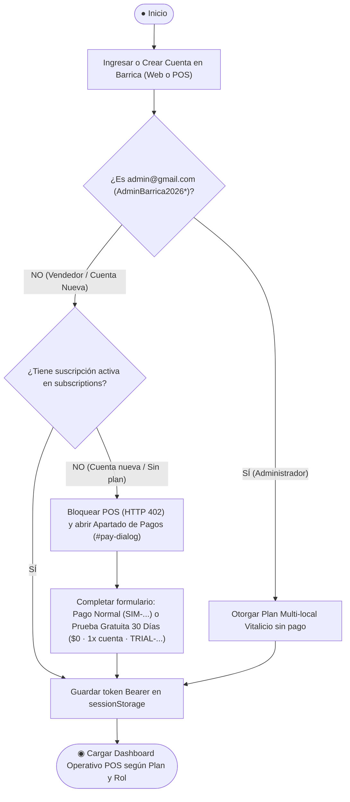

</details>

#### 4.3.2 Flujo Operativo de Turno de Caja, Pedido en Mesa, Cobro y Cierre Consolidado

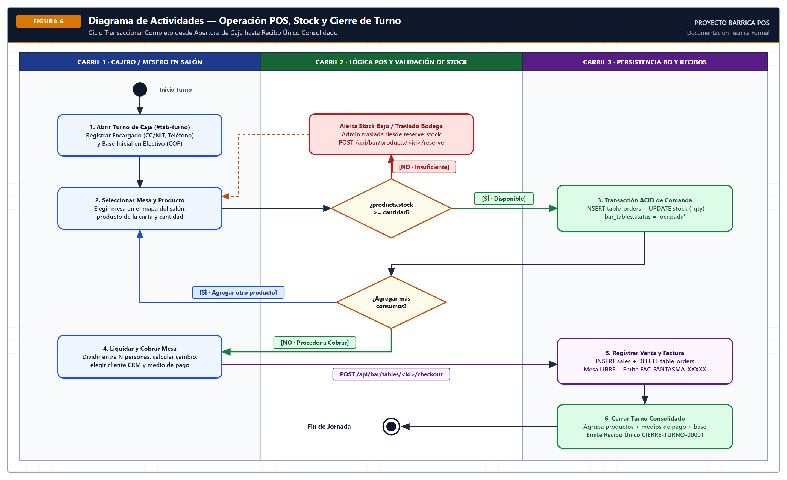

| Paso | Nodo / Tipo UML | Actividad Operativa en el Salón | Regla de Validación / Transacción | Estado Resultante |
| :---: | :---: | :--- | :--- | :--- |
| **1** | `● Inicio Turno` | Encargado abre turno en `#tab-turno` (`POST /api/bar/shifts/open`) | Registra nombre, documento (`CC/CE/NIT`), teléfono, cargo y base inicial COP | Turno `ABIERTO` en memoria operativa |
| **2** | `▭ Selección` | Selecciona mesa en el mapa del salón y elige producto + cantidad | Consulta existencias actuales en `products.stock` | Evalúa disponibilidad |
| **3** | `◇ Decisión Stock` | **¿`products.stock >= cantidad` solicitada?** | • **NO**: Si hay `reserve_stock`, Admin traslada de Bodega a Barra (`POST .../reserve`)<br>• **SÍ**: Continúa transacción | Stock validado |
| **4** | `▭ Comanda ACID` | Inserta línea en `table_orders` y descuenta `products.stock` | Actualiza `bar_tables.status = 'ocupada'` en un solo `commit()` | Mesa `OCUPADA` y stock actualizado |
| **5** | `▭ Liquidación` | Divide cuenta entre *N* personas, calcula vueltas y asocia cliente CRM | Ejecuta `POST /api/bar/tables/<id>/checkout` | Inserta en `sales`, emite `FAC-FANTASMA-XXXXX` y libera mesa (`libre`) |
| **6** | `◉ Cierre Turno` | Al terminar jornada pulsa **Cerrar Turno** (`POST /api/bar/shifts/close`) | Agrupa ventas por producto y medio de pago + suma base inicial + efectivo | Emite recibo único **`CIERRE-TURNO-00001`** |

<details>
<summary><b>📊 Expandir / Contraer Código Mermaid Editable (Operación y Turno)</b></summary>

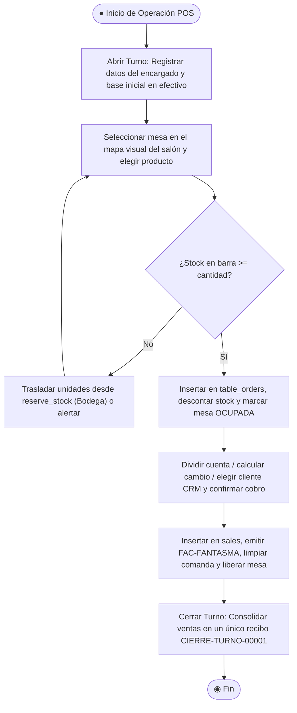

</details>

---

### 4.4 Diagramas de Secuencias

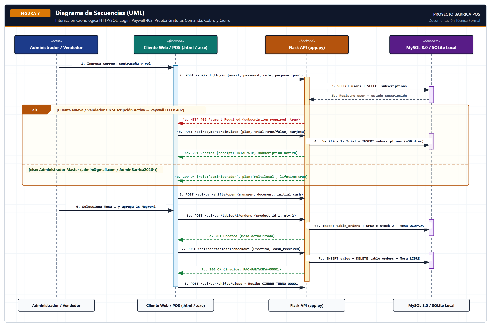

#### Tabla Dinámica de Secuencia Cronológica de Mensajes (Login → Paywall/Trial → Comanda → Cobro → Cierre)

| Orden | Emisor | Receptor | Mensaje HTTP / SQL Ejecutado | Respuesta / Efecto en el Sistema |
| :---: | :--- | :--- | :--- | :--- |
| **1** | `Actor (Usuario)` | `Cliente POS / Web` | Ingresa correo y contraseña (registro o login) | Envía petición JSON autenticada |
| **2** | `Cliente POS / Web` | `Flask API (app.py)` | `POST /api/auth/login` `{email, password, role, purpose: "pos"}` | Valida credenciales contra `users` |
| **3** | `Flask API` | `MySQL / SQLite DB` | `SELECT id, full_name, password_hash, role FROM users WHERE email = ?` | Verifica `bcrypt` (o acceso directo de `admin@gmail.com`) |
| **4a** | `Flask API` | `Cliente POS` | *(Si es cuenta nueva sin plan)*: **`HTTP 402 Payment Required`** `{subscription_required: true}` | Redirige de inmediato al **Apartado de Pagos (`#pay-dialog`)** |
| **4b** | `Cliente Web` | `Flask API` | `POST /api/payments/simulate` `{plan, trial: true/false, payer_name, card_last4, ...}` | Verifica `_has_used_free_trial()`, inserta en `subscriptions` (+30 días) y devuelve **`201 Created`** con recibo `TRIAL-...` o `SIM-...` |
| **5** | `Cliente POS` | `Flask API` | `POST /api/bar/shifts/open` `{manager_name, document_number, phone, initial_cash_cop}` | **`201 Created`** — Inicia `active_shift` |
| **6** | `Cliente POS` | `Flask API` | `POST /api/bar/tables/1/orders` `{product_id: 1, quantity: 2}` (`Bearer token`) | `INSERT INTO table_orders` + `UPDATE products SET stock = stock - 2` + `status = 'ocupada'` (**`201 Created`**) |
| **7** | `Cliente POS` | `Flask API` | `POST /api/bar/tables/1/checkout` `{payment_method: "Efectivo", cash_received: 100000}` | `INSERT INTO sales` + `DELETE FROM table_orders` + `status = 'libre'` + emite **`FAC-FANTASMA-00001`** (**`200 OK`**) |
| **8** | `Cliente POS` | `Flask API` | `POST /api/bar/shifts/close` `{}` | Ejecuta `_consolidate_shift_receipt()` y devuelve **`200 OK`** con recibo único **`CIERRE-TURNO-00001`** |

<details>
<summary><b>📊 Expandir / Contraer Código Mermaid Editable de Secuencias</b></summary>

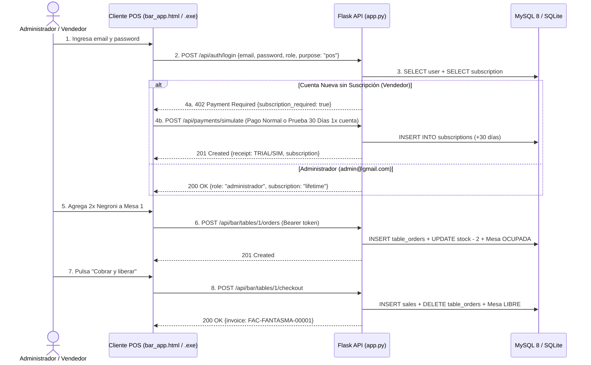

</details>

---

## 5. Documentación de Casos de Uso (Fichas Técnicas)

### CU-01: Iniciar Sesión Obligatoria, Bloqueo POS sin Plan y Activación de Prueba Gratuita Única de 30 Días

| Atributo | Especificación Técnica |
| :--- | :--- |
| **Código** | `CU-01` |
| **Nombre** | Iniciar sesión por rol, redirigir cuentas nuevas sin plan a Pagos y activar suscripción o prueba gratuita única de 30 días |
| **Actores** | **Administrador Vitalicio** (`admin@gmail.com`), **Vendedor / Cuenta Nueva** |
| **Descripción** | El sistema autentica al usuario verificando su rol. El Administrador (`admin@gmail.com` / `AdminBarrica2026*`) goza de acceso total vitalicio desde cualquier interfaz sin requerir pago. Toda cuenta nueva de Vendedor nace sin suscripción activa: al intentar entrar al POS es redirigida automáticamente al apartado de pagos (`#pay-dialog`), donde puede activar su plan llenando el formulario ya sea con **Pago Normal** o con la opción de **Prueba Gratuita de 30 Días ($0, limitada a 1 sola vez por cuenta)**. |
| **Precondiciones** | Cuenta registrada en `users` (o credenciales maestras de administrador). |
| **Flujo Normal** | 1. El usuario inicia sesión o registra una cuenta nueva.<br>2. Si es `admin@gmail.com` (`AdminBarrica2026*`), el servidor le asigna rol `administrador` y plan `Multi-local` vitalicio (`lifetime`) y abre directamente el sistema.<br>3. Si es una cuenta nueva de `vendedor` e intenta ingresar al POS, el servidor detecta que no tiene suscripción activa (`HTTP 402`) y abre de inmediato el apartado de pagos (`#pay-dialog`).<br>4. En el apartado de pagos, el usuario elige su plan (`Básico`, `Pro` o `Multi-local`) y selecciona la modalidad **💳 Pago normal** o **🎁 Prueba gratuita 30 días ($0)**.<br>5. Completa los datos del formulario de pago y confirma.<br>6. El servidor verifica en `subscriptions` que la cuenta no haya usado antes su prueba gratuita (`_has_used_free_trial`), registra la suscripción por 30 días, emite el comprobante (`TRIAL-...` o `SIM-...`) y habilita el ingreso inmediato al Sistema POS. |
| **Flujos Alternativos** | - **5a. Cuenta intenta activar una segunda prueba gratuita de 30 días:** El servidor rechaza la solicitud con **HTTP `409 Conflict`** (`trial_used: true`), deshabilita el botón de prueba gratuita en esa cuenta y solicita usar la opción de **Pago normal**.<br>- **2a. Credenciales incorrectas:** Se registra en `auth_attempts` y devuelve HTTP `401`. |
| **Postcondiciones** | Comprobante emitido en pantalla, suscripción vigente por 30 días en `subscriptions` y acceso al POS desbloqueado. |

### CU-02: Abrir y Cerrar Turno de Caja con Recibo Único Consolidado

| Atributo | Especificación Técnica |
| :--- | :--- |
| **Código** | `CU-02` |
| **Nombre** | Abrir y cerrar turno de caja con arqueo consolidado (`CIERRE-TURNO-XXXXX`) |
| **Actores** | Administrador, Vendedor (Encargado de Caja) |
| **Descripción** | Registra formalmente al responsable de la caja al iniciar la jornada y emite un único comprobante consolidado de cierre con todos los productos vendidos y el arqueo financiero del turno. |
| **Precondiciones** | Sesión POS autenticada y ningún otro turno abierto simultáneamente (`active_shift == None`). |
| **Flujo Normal** | 1. El encargado abre el módulo **Turno y Cierre** y diligencia: nombre completo, tipo y número de documento (`CC`, `CE`, `NIT`, `PASAPORTE`), teléfono, cargo y base inicial en efectivo.<br>2. El sistema valida los datos (`POST /api/bar/shifts/open`) e inicia el turno activo.<br>3. Todos los cobros de mesas realizados durante el turno se vinculan automáticamente al turno activo.<br>4. Al finalizar la jornada, el encargado pulsa **Cerrar Turno** (`POST /api/bar/shifts/close`).<br>5. El sistema agrupa todas las ventas por producto y por método de pago, suma la base inicial más el efectivo recaudado y emite el recibo único `CIERRE-TURNO-XXXXX`. |
| **Flujos Alternativos** | - **2a. Ya existe un turno abierto:** El servidor responde HTTP `409 Conflict` indicando que debe cerrarse el turno vigente antes de abrir otro. |
| **Postcondiciones** | Turno cerrado, archivado en `closed_shifts` y recibo consolidado listo para impresión. |

### CU-03: Tomar Pedido en Mesa con Descuento Automático de Stock

| Atributo | Especificación Técnica |
| :--- | :--- |
| **Código** | `CU-03` |
| **Nombre** | Registrar consumo en mesa y descontar inventario en tiempo real |
| **Actores** | Administrador, Vendedor |
| **Descripción** | Asigna bebidas o platos a una mesa del salón descontando inmediatamente las unidades del stock disponible en barra. |
| **Precondiciones** | Sesión POS activa, mesa existente en `bar_tables` y producto con `stock >= cantidad`. |
| **Flujo Normal** | 1. El actor selecciona una mesa en el mapa del salón.<br>2. Elige un producto de la carta e indica la cantidad.<br>3. Envía `POST /api/bar/tables/<id>/orders`.<br>4. El servidor verifica el stock actual del producto en `products`, inserta o acumula en `table_orders`, resta `quantity` de `products.stock` y actualiza `bar_tables.status = 'ocupada'`. |
| **Flujos Alternativos** | - **4a. Stock insuficiente:** Devuelve HTTP `400` informando las unidades disponibles.<br>- **4b. Eliminación de ítem (`DELETE /api/bar/orders/<id>`):** Restaura las unidades a `products.stock` y libera la mesa si queda sin ítems. |
| **Postcondiciones** | Comanda actualizada en `table_orders`, stock descontado en `products` y alerta visual si `stock <= min_stock`. |

### CU-04: Dividir Cuenta, Asociar Cliente CRM y Cobrar Mesa (Factura Fantasma)

| Atributo | Especificación Técnica |
| :--- | :--- |
| **Código** | `CU-04` |
| **Nombre** | Liquidar cuenta de mesa, registrar venta y emitir factura fantasma (`FAC-FANTASMA-XXXXX`) |
| **Actores** | Administrador, Vendedor |
| **Descripción** | Calcula el total de la mesa, permite dividir la cuenta entre varios comensales, calcula el cambio en efectivo, asocia un cliente del CRM y cierra la venta generando su comprobante. |
| **Precondiciones** | Mesa con al menos un pedido activo en `table_orders`. |
| **Flujo Normal** | 1. El actor selecciona la mesa ocupada o por cobrar.<br>2. Opcionalmente divide la cuenta entre *N* personas, digita el efectivo recibido para calcular el cambio, selecciona cliente CRM y medio de pago (`Efectivo`, `Tarjeta`, `Transferencia / Nequi`).<br>3. Pulsa **Cobrar y liberar mesa** (`POST /api/bar/tables/<id>/checkout`).<br>4. El servidor inserta la venta en `sales`, limpia `table_orders`, libera `bar_tables` y genera la factura `FAC-FANTASMA-XXXXX`. |
| **Flujos Alternativos** | - **3a. Mesa sin consumos:** El servidor rechaza el cobro con HTTP `400`. |
| **Postcondiciones** | Venta persistida en `sales`, factura `FAC-FANTASMA` archivada y mesa libre. |

### CU-05: Administrar Inventario MySQL y Bodega de Reserva

| Atributo | Especificación Técnica |
| :--- | :--- |
| **Código** | `CU-05` |
| **Nombre** | Crear productos, ajustar existencias y trasladar desde bodega de reserva |
| **Actores** | Administrador |
| **Descripción** | Permite mantener el catálogo de productos del bar, sus precios, fotografía, stock en barra y unidades en bodega de reserva. |
| **Precondiciones** | Sesión activa con rol `administrador`. |
| **Flujo Normal** | 1. El administrador abre **Carta e Inventario**.<br>2. Crea productos (`POST /api/bar/products`), ajusta existencias rápidas (`-1`, `+1`, `+10` en `POST /api/bar/products/<id>/stock`) o traslada unidades de `reserve_stock` a `stock` (`POST /api/bar/products/<id>/reserve`). |
| **Flujos Alternativos** | - **1a. Usuario Vendedor:** Solo lectura; escritura rechazada con HTTP `403`. |
| **Postcondiciones** | Catálogo y existencias actualizados en tiempo real. |

### CU-06: Gestionar CRM de Clientes con Clasificación Imprimible por País

| Atributo | Especificación Técnica |
| :--- | :--- |
| **Código** | `CU-06` |
| **Nombre** | Registrar clientes, clasificarlos por país e imprimir listado o facturas |
| **Actores** | Administrador, Vendedor |
| **Descripción** | Administra el directorio de clientes frecuentes del bar y permite filtrarlos e imprimir reportes agrupados por país, así como auditar facturas fantasma (solo Administrador). |
| **Precondiciones** | Sesión activa en `bar_app.html`. |
| **Flujo Normal** | 1. Registra cliente con nombre, correo, teléfono, dirección, ciudad y país.<br>2. Filtra o imprime el reporte clasificado por país.<br>3. El Administrador consulta y reimprime cualquier comprobante `FAC-FANTASMA-XXXXX`. |
| **Postcondiciones** | Cliente disponible en caja y reportes listos para impresión. |

### CU-07: Auditar Usuarios, Sesiones, Ventas por Periodo y Asignar Roles

| Atributo | Especificación Técnica |
| :--- | :--- |
| **Código** | `CU-07` |
| **Nombre** | Administrar roles del equipo, auditar sesiones y consultar KPIs de ventas |
| **Actores** | Administrador |
| **Descripción** | Supervisa cuentas registradas, sesiones activas/expiradas, ingresos por día/semana/mes/año y promueve o degrada roles de usuario. |
| **Precondiciones** | Sesión activa con rol `administrador`. |
| **Flujo Normal** | 1. Abre **Administración** (`GET /api/bar/dashboard`).<br>2. Consulta KPIs financieros, usuarios y sesiones.<br>3. Cambia roles con `POST /api/bar/users/<id>/role` preservando siempre al menos un administrador activo. |
| **Postcondiciones** | Rol actualizado en `users` y `sessions`. |

### CU-08: Operar en Modo Demo Local JSON / Respaldo SQLite Local

| Atributo | Especificación Técnica |
| :--- | :--- |
| **Código** | `CU-08` |
| **Nombre** | Ejecutar el sistema sin MySQL externo mediante SQLite local o almacenamiento JSON |
| **Actores** | Administrador, Vendedor |
| **Descripción** | Permite operar todas las funciones del sistema incluso sin conexión a Aiven MySQL gracias al motor local automático `barrica_local.sqlite3` en Flask y al Modo Demo Local JSON del navegador. |
| **Precondiciones** | Ejecutar `iniciar_bar_app.bat`, `py app.py` o `iniciar_demo_local_json.bat`. |
| **Flujo Normal** | 1. El sistema inicializa las 8 tablas con inventario semilla, mesas y la cuenta `admin@gmail.com` (`AdminBarrica2026*`) con acceso Multi-local vitalicio.<br>2. Todas las operaciones funcionan con persistencia local y permiten exportar/importar copias `.json`. |
| **Postcondiciones** | Operación autónoma completa sin depender de servidores externos. |

---

## 6. Scripts de la Base de Datos

- **Esquema principal DDL:** [`database/schema.sql`](../database/schema.sql)
- **Ejecutor automático de esquema y migraciones en Aiven MySQL:** [`database/run_schema.py`](../database/run_schema.py)
- **Gestor CLI de usuarios, sesiones y restablecimiento seguro de administrador:** [`conection.py`](../conection.py)

<details open>
<summary><b>📜 6.1 Ver Script DDL Principal (<code>database/schema.sql</code>)</b></summary>

```sql
CREATE DATABASE IF NOT EXISTS barika_db;
USE barika_db;

CREATE TABLE IF NOT EXISTS users (
    id BIGINT UNSIGNED NOT NULL AUTO_INCREMENT,
    full_name VARCHAR(120) NOT NULL,
    email VARCHAR(254) NOT NULL,
    password_hash VARCHAR(100) NOT NULL,
    role VARCHAR(20) NOT NULL DEFAULT 'vendedor',
    created_at TIMESTAMP NOT NULL DEFAULT CURRENT_TIMESTAMP,
    PRIMARY KEY (id),
    UNIQUE KEY uq_users_email (email)
) ENGINE=InnoDB DEFAULT CHARSET=utf8mb4 COLLATE=utf8mb4_unicode_ci;

CREATE TABLE IF NOT EXISTS sessions (
    token_hash CHAR(64) CHARACTER SET ascii COLLATE ascii_bin NOT NULL,
    user_id BIGINT UNSIGNED NOT NULL,
    role VARCHAR(20) NOT NULL DEFAULT 'vendedor',
    expires_at DATETIME NOT NULL,
    created_at TIMESTAMP NOT NULL DEFAULT CURRENT_TIMESTAMP,
    PRIMARY KEY (token_hash),
    KEY idx_sessions_user_id (user_id),
    KEY idx_sessions_expires_at (expires_at),
    CONSTRAINT fk_sessions_user
        FOREIGN KEY (user_id) REFERENCES users (id) ON DELETE CASCADE
) ENGINE=InnoDB DEFAULT CHARSET=utf8mb4 COLLATE=utf8mb4_unicode_ci;

CREATE TABLE IF NOT EXISTS auth_attempts (
    key_hash CHAR(64) CHARACTER SET ascii COLLATE ascii_bin NOT NULL,
    attempts SMALLINT UNSIGNED NOT NULL DEFAULT 0,
    window_started_at DATETIME NOT NULL,
    last_attempt_at DATETIME NOT NULL,
    PRIMARY KEY (key_hash),
    KEY idx_auth_attempts_last_attempt_at (last_attempt_at)
) ENGINE=InnoDB DEFAULT CHARSET=utf8mb4 COLLATE=utf8mb4_unicode_ci;

CREATE TABLE IF NOT EXISTS products (
    id INT UNSIGNED NOT NULL AUTO_INCREMENT,
    name VARCHAR(120) NOT NULL,
    category VARCHAR(60) NOT NULL DEFAULT 'Licores',
    price_cop INT UNSIGNED NOT NULL,
    stock INT NOT NULL DEFAULT 0,
    min_stock INT NOT NULL DEFAULT 5,
    reserve_stock INT NOT NULL DEFAULT 0,
    image_url VARCHAR(500) NULL,
    created_at TIMESTAMP NOT NULL DEFAULT CURRENT_TIMESTAMP,
    PRIMARY KEY (id)
) ENGINE=InnoDB DEFAULT CHARSET=utf8mb4 COLLATE=utf8mb4_unicode_ci;

CREATE TABLE IF NOT EXISTS bar_tables (
    id INT UNSIGNED NOT NULL AUTO_INCREMENT,
    table_number INT UNSIGNED NOT NULL,
    label VARCHAR(60) NOT NULL,
    capacity SMALLINT UNSIGNED NOT NULL DEFAULT 4,
    status VARCHAR(20) NOT NULL DEFAULT 'libre',
    PRIMARY KEY (id),
    UNIQUE KEY uq_bar_tables_number (table_number)
) ENGINE=InnoDB DEFAULT CHARSET=utf8mb4 COLLATE=utf8mb4_unicode_ci;

CREATE TABLE IF NOT EXISTS table_orders (
    id BIGINT UNSIGNED NOT NULL AUTO_INCREMENT,
    table_id INT UNSIGNED NOT NULL,
    product_id INT UNSIGNED NULL,
    product_name VARCHAR(120) NOT NULL,
    quantity INT UNSIGNED NOT NULL DEFAULT 1,
    unit_price_cop INT UNSIGNED NOT NULL,
    created_at TIMESTAMP NOT NULL DEFAULT CURRENT_TIMESTAMP,
    PRIMARY KEY (id),
    KEY idx_table_orders_table_id (table_id),
    CONSTRAINT fk_table_orders_table
        FOREIGN KEY (table_id) REFERENCES bar_tables (id) ON DELETE CASCADE,
    CONSTRAINT fk_table_orders_product
        FOREIGN KEY (product_id) REFERENCES products (id) ON DELETE SET NULL
) ENGINE=InnoDB DEFAULT CHARSET=utf8mb4 COLLATE=utf8mb4_unicode_ci;

CREATE TABLE IF NOT EXISTS sales (
    id BIGINT UNSIGNED NOT NULL AUTO_INCREMENT,
    table_label VARCHAR(60) NOT NULL,
    items_summary VARCHAR(500) NOT NULL,
    total_cop INT UNSIGNED NOT NULL,
    payment_method VARCHAR(40) NOT NULL DEFAULT 'Efectivo',
    created_at TIMESTAMP NOT NULL DEFAULT CURRENT_TIMESTAMP,
    PRIMARY KEY (id),
    KEY idx_sales_created_at (created_at)
) ENGINE=InnoDB DEFAULT CHARSET=utf8mb4 COLLATE=utf8mb4_unicode_ci;

CREATE TABLE IF NOT EXISTS subscriptions (
    id BIGINT UNSIGNED NOT NULL AUTO_INCREMENT,
    user_id BIGINT UNSIGNED NOT NULL,
    plan_id VARCHAR(30) NOT NULL,
    status VARCHAR(20) NOT NULL DEFAULT 'pending',
    payment_reference VARCHAR(80) NULL,
    starts_at DATETIME NOT NULL,
    expires_at DATETIME NOT NULL,
    created_at TIMESTAMP NOT NULL DEFAULT CURRENT_TIMESTAMP,
    PRIMARY KEY (id),
    KEY idx_subscriptions_user_status_expiry (user_id, status, expires_at),
    UNIQUE KEY uq_subscriptions_payment_reference (payment_reference),
    CONSTRAINT fk_subscriptions_user FOREIGN KEY (user_id) REFERENCES users (id) ON DELETE CASCADE
) ENGINE=InnoDB DEFAULT CHARSET=utf8mb4 COLLATE=utf8mb4_unicode_ci;
```

</details>

---

## 7. Backup de Base de Datos

Archivo fuente: [`database/backup_barrica.sql`](../database/backup_barrica.sql)

<details>
<summary><b>💾 Expandir / Contraer Backup SQL Completo (<code>database/backup_barrica.sql</code>)</b></summary>

```sql
USE barika_db;
SET NAMES utf8mb4;
SET FOREIGN_KEY_CHECKS = 0;

INSERT IGNORE INTO `bar_tables` (`id`, `table_number`, `label`, `capacity`, `status`) VALUES
(1, 1, 'Mesa 1 · Salón', 4, 'libre'),
(2, 2, 'Mesa 2 · Salón', 4, 'libre'),
(3, 3, 'Mesa 3 · Ventana', 2, 'libre'),
(4, 4, 'Mesa 4 · Terraza', 6, 'libre'),
(5, 5, 'Mesa 5 · Terraza', 4, 'libre'),
(6, 6, 'Mesa 6 · VIP', 8, 'libre'),
(7, 7, 'Barra 1 · Principal', 2, 'libre'),
(8, 8, 'Barra 2 · Principal', 2, 'libre');

INSERT IGNORE INTO `products` (`id`, `name`, `category`, `price_cop`, `stock`, `min_stock`) VALUES
(1, 'Negroni', 'Cócteles', 28000, 24, 5),
(2, 'Old Fashioned', 'Cócteles', 30000, 20, 5),
(3, 'Margarita Artesanal', 'Cócteles', 26000, 18, 5),
(4, 'Cerveza Club Colombia', 'Cervezas', 9000, 48, 12),
(5, 'Cerveza Artesanal IPA', 'Cervezas', 15000, 30, 8),
(6, 'Botella Ginebra Tanqueray', 'Licores', 165000, 3, 4),
(7, 'Botella Aguardiente Antioqueño', 'Licores', 85000, 10, 4),
(8, 'Tabla de Quesos y Madurados', 'Comida', 42000, 12, 3);

SET FOREIGN_KEY_CHECKS = 1;
```

</details>

---

## 8. Mockups de la Aplicación

### 8.1 Mockup en Tabla Dinámica: Apartado de Pagos, Prueba Gratuita de 30 Días (`1x Cuenta`) y Comprobante (`Untitled-1.html`)

| Paso 1: Formulario de Activación (`#pay-dialog`) | Paso 2: Comprobante Emitido (`#pay-receipt-pane`) |
| :--- | :--- |
| **Plan Seleccionado:** `Pro ($59,00 USD / $236.000 COP)`<br>**Modalidad de Activación:**<br>• `[ 💳 Pago normal ]` *(Suscripción mensual con recibo SIM)*<br>• **`[ 🎁 Prueba gratuita 30 días ($0 hoy · 1 por cuenta) ] (ACTIVO)`**<br>---<br>**Total a pagar hoy:** **`$0,00 USD`** *(30 días gratis)*<br>**Datos del Pagador:** `Camila Rojas` · `camili123@gmail.com`<br>**Documento y Teléfono:** `CC 1020304050` · `3001234567`<br>**Tarjeta Registrada:** `Visa 4532 •••• •••• 4242` · `Venc: 12/28` · `CVV: 123`<br>---<br>**Botón Principal:** **`[ Activar prueba gratuita de 30 días ($0,00 USD) ]`** | **Sello:** **`PRUEBA GRATUITA ACTIVA · 30 DÍAS`**<br>**Marca:** `Barrica POS` — **Comprobante:** `N.º TRIAL-20261123-A9F4C1`<br>---<br>• **Fecha:** `23 nov 2026, 09:10 a. m.`<br>• **Plan:** `Pro, 30 días (Prueba gratuita)`<br>• **Estado:** 🟢 `Prueba gratuita activa (30 días)`<br>• **Pagador:** `Camila Rojas` (`CC 1020304050`)<br>• **Método:** `Visa terminada en 4242 (Prueba gratuita 30 días · $0)`<br>• **TOTAL PAGADO:** **`$0,00 USD`**<br>---<br>**Acciones:** **`[ Ir al Sistema POS ↗ ]`** · `[ Imprimir o guardar en PDF ]` |

### 8.2 Mockup en Tabla Dinámica: Inicio de Sesión por Rol (`Untitled-1.html` / `bar_app.html`)

| Selector de Perfil (`Vendedor` vs `Administrador`) | Formulario de Credenciales y Reglas de Acceso |
| :--- | :--- |
| • **`[ ▣ VENDEDOR ]`**: Mesas, pedidos, turnos, clientes y cobros *(Exige plan activo o activar los 30 días gratis en `#pay-dialog`)*<br>• **`[ ◈ ADMINISTRADOR ]`**: Inventario, bodega, roles, facturas, sesiones y KPIs *(Acceso total vitalicio para `admin@gmail.com`)* | **Correo electrónico:** `admin@gmail.com`<br>**Contraseña:** `AdminBarrica2026*`<br>**Acción:** **`[ Ingresar como Administrador ]`**<br>→ *Entra directo desde la página principal o desde el POS sin pedir pago* |

### 8.3 Mockup en Tabla Dinámica: Salón de Mesas, Comanda Activa y Cobro POS (`bar_app.html`)

| Mapa Visual de Mesas del Salón (`bar_tables`) | Panel de Comanda Activa y Liquidación (`Mesa 1 · Salón`) |
| :--- | :--- |
| • **Mesa 1 · Salón** (4 puestos): 🟡 **`OCUPADA`** — **`$98.000 COP`**<br>• **Mesa 2 · Salón** (4 puestos): 🟢 **`LIBRE`** — `Disponible`<br>• **Mesa 3 · Ventana** (2 puestos): 🔴 **`POR COBRAR`** — **`$52.000 COP`**<br>• **Mesa 4 · Terraza** (6 puestos): 🟢 **`LIBRE`** — `Disponible`<br>• **Mesa 5 · Terraza** (4 puestos): 🟢 **`LIBRE`** — `Disponible`<br>• **Mesa 6 · VIP** (8 puestos): 🟢 **`LIBRE`** — `Disponible`<br>• **Barra 1 y 2 · Principal**: 🟢 **`LIBRE`** — `Disponible` | **Consumos en `table_orders`:**<br>• `2x Negroni ($28.000)` .................................. **`$56.000`**<br>• `1x Tabla de Quesos y Madurados ($42.000)` ... **`$42.000`**<br>---<br>• **Cliente CRM:** `Cliente VIP (Colombia)`<br>• **Medio de Pago:** `Efectivo ($100.000 recibido → Cambio: $2.000)`<br>• **Dividir cuenta (2 personas):** `$49.000 COP c/u`<br>• **TOTAL A COBRAR:** **`$98.000 COP`**<br>**Acción:** **`[ Cobrar Mesa y Emitir FAC-FANTASMA-00001 ]`** |

### 8.4 Mockup en Tabla Dinámica: Apertura de Turno y Recibo Único Consolidado (`CIERRE-TURNO-00001`)

| Formulario de Apertura de Turno (`#shift-open-panel`) | Recibo Único Consolidado del Día (`CIERRE-TURNO-00001`) |
| :--- | :--- |
| • **Nombre del Encargado:** `Camila Rojas`<br>• **Documento:** `CC 1020304050`<br>• **Teléfono:** `3001234567`<br>• **Puesto / Cargo:** `Encargada de Barra`<br>• **Base Inicial en Caja:** **`$50.000 COP`**<br>**Acción:** **`[ 🔓 Abrir Turno con mis Datos Personales ]`** | • **Folio:** **`CIERRE-TURNO-00001`** (`Camila Rojas · CC 1020304050`)<br>• **Productos Vendidos:** `5 unidades en 2 cuentas`<br>• **Efectivo:** `$56.000 COP` · **Transferencia / Nequi:** `$27.000 COP`<br>• **TOTAL VENTAS DEL TURNO:** **`$83.000 COP`**<br>• **EFECTIVO ESPERADO EN CAJA (Base + Efectivo):** **`$106.000 COP`**<br>**Acción:** **`[ 🖨️ Imprimir Recibo Único del Día ]`** |

---

## 9. Enlace de Código Fuente de la Aplicación en un Repositorio de GIT

Todo el código fuente del proyecto **Barrica POS**, junto con sus scripts de base de datos, pruebas unitarias, aplicación de escritorio y documentación técnica, se encuentra alojado y versionado en **GitHub**:

- **URL del Repositorio en GitHub:** https://github.com/andresmunoz-dot/Gestion-Bar
- **URL de Clonación HTTPS (Git):** `https://github.com/andresmunoz-dot/Gestion-Bar.git`
- **Rama Principal:** `master`
- **Autor / Propietario:** `andresmunoz-dot` (Andrés Muñoz)

### 9.1 Enlaces Directos a los Módulos del Código Fuente en GitHub

| Componente del Sistema | Estado | Enlace Directo en el Repositorio Git |
| :--- | :---: | :--- |
| **Repositorio Principal (Raíz)** | 🟢 Activo | https://github.com/andresmunoz-dot/Gestion-Bar |
| **Backend Flask, Paywall, Trial 30d y API REST (`app.py`)** | 🟢 Activo | https://github.com/andresmunoz-dot/Gestion-Bar/blob/master/app.py |
| **Aplicación Operativa POS / PWA / Demo Local JSON (`bar_app.html`)** | 🟢 Activo | https://github.com/andresmunoz-dot/Gestion-Bar/blob/master/bar_app.html |
| **Portal Web Principal y Checkout (`Untitled-1.html`)** | 🟢 Activo | https://github.com/andresmunoz-dot/Gestion-Bar/blob/master/Untitled-1.html |
| **Código Fuente App Escritorio C# (`desktop/BarricaDesktop.cs`)** | 🟢 Activo | https://github.com/andresmunoz-dot/Gestion-Bar/blob/master/desktop/BarricaDesktop.cs |
| **Ejecutable Windows (`downloads/BarricaDesktop.exe`)** | 🟢 Activo | https://github.com/andresmunoz-dot/Gestion-Bar/blob/master/downloads/BarricaDesktop.exe |
| **Script DDL Base de Datos (`database/schema.sql`)** | 🟢 Activo | https://github.com/andresmunoz-dot/Gestion-Bar/blob/master/database/schema.sql |
| **Backup Base de Datos (`database/backup_barrica.sql`)** | 🟢 Activo | https://github.com/andresmunoz-dot/Gestion-Bar/blob/master/database/backup_barrica.sql |
| **Ejecutor de Esquema y Migraciones (`database/run_schema.py`)** | 🟢 Activo | https://github.com/andresmunoz-dot/Gestion-Bar/blob/master/database/run_schema.py |
| **CLI de Usuarios, Sesiones y Admin (`conection.py`)** | 🟢 Activo | https://github.com/andresmunoz-dot/Gestion-Bar/blob/master/conection.py |
| **Suite de 44 Pruebas Unitarias (`tests/`)** | 🟢 44 OK | https://github.com/andresmunoz-dot/Gestion-Bar/tree/master/tests |
| **Documentación Técnica en Word (`docs/DOCUMENTACION_TECNICA.docx`)** | 🟢 Activo | https://github.com/andresmunoz-dot/Gestion-Bar/blob/master/docs/DOCUMENTACION_TECNICA.docx |
| **Trabajo Escrito en Word (`docs/Trabajo_Escrito_Barrica_POS.docx`)** | 🟢 Activo | https://github.com/andresmunoz-dot/Gestion-Bar/blob/master/docs/Trabajo_Escrito_Barrica_POS.docx |

### 9.2 Comandos para Clonar y Ejecutar desde Git

```powershell
git clone https://github.com/andresmunoz-dot/Gestion-Bar.git
cd Gestion-Bar
.\iniciar_bar_app.bat
```
