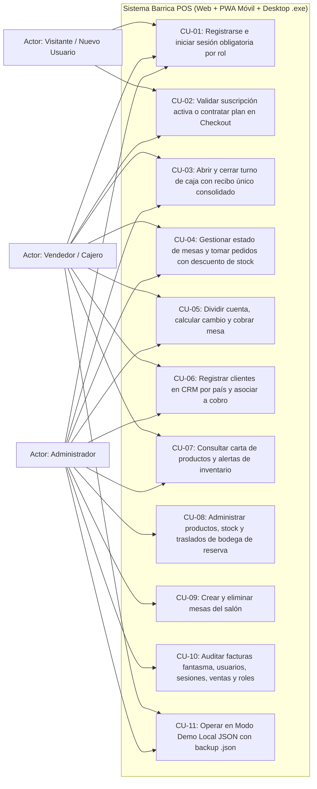
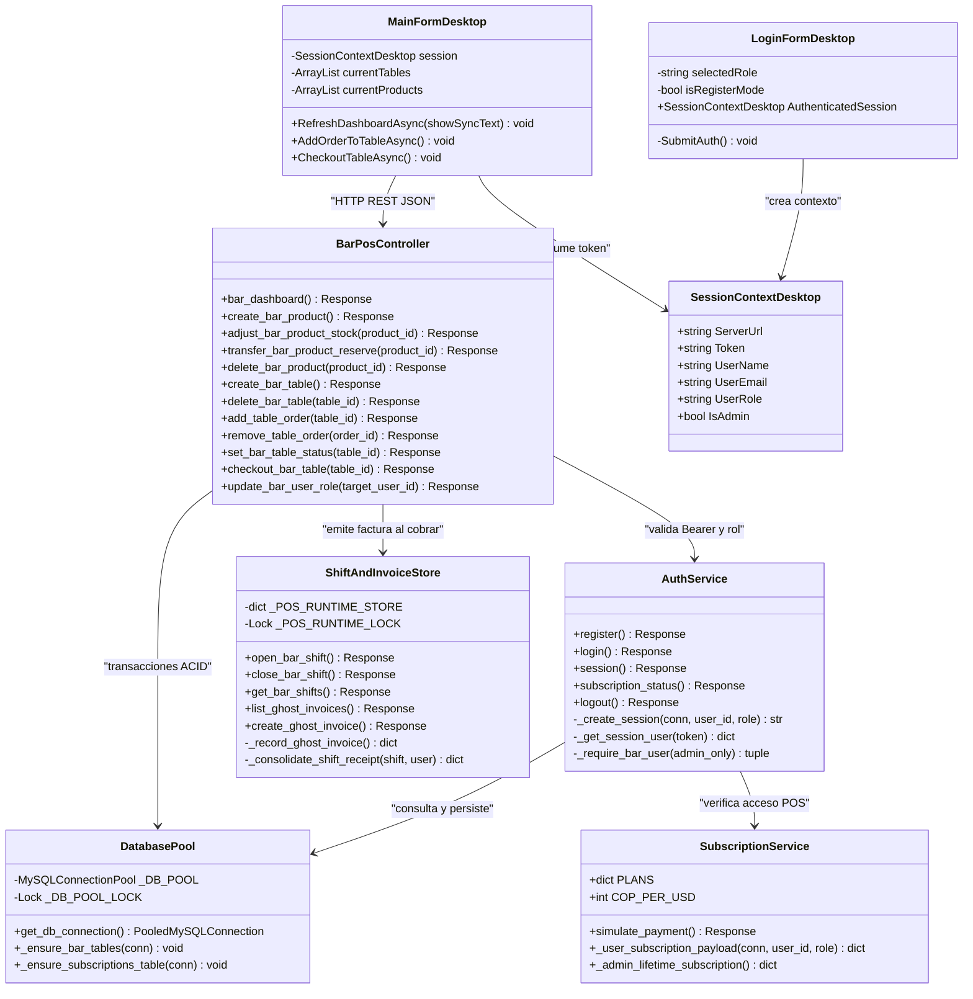
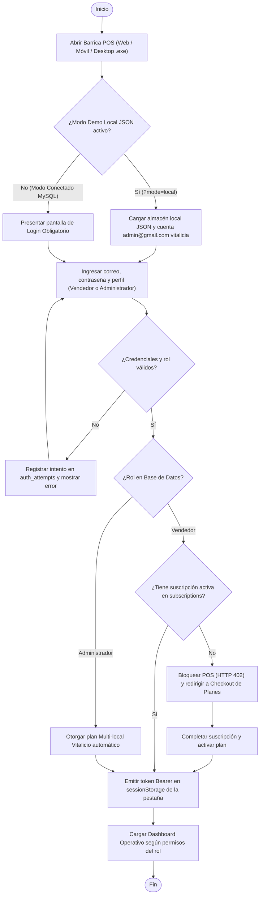
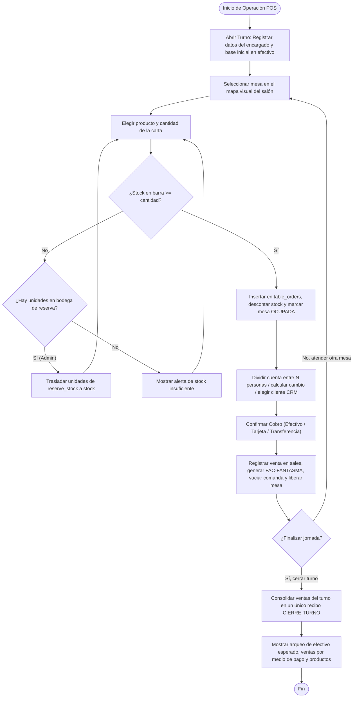
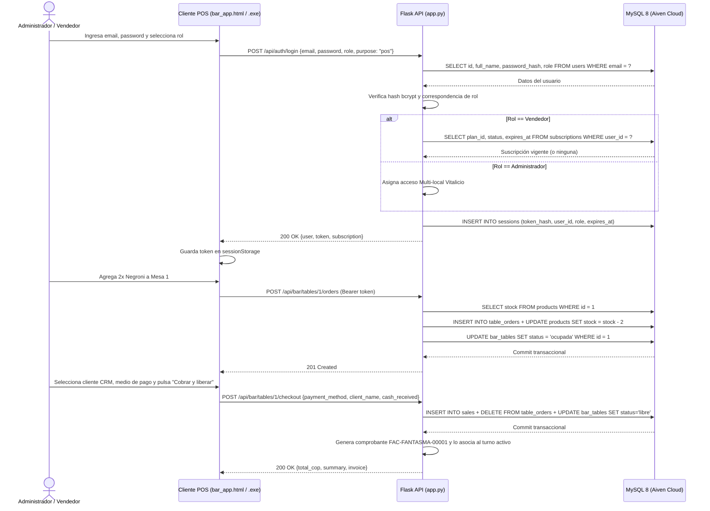
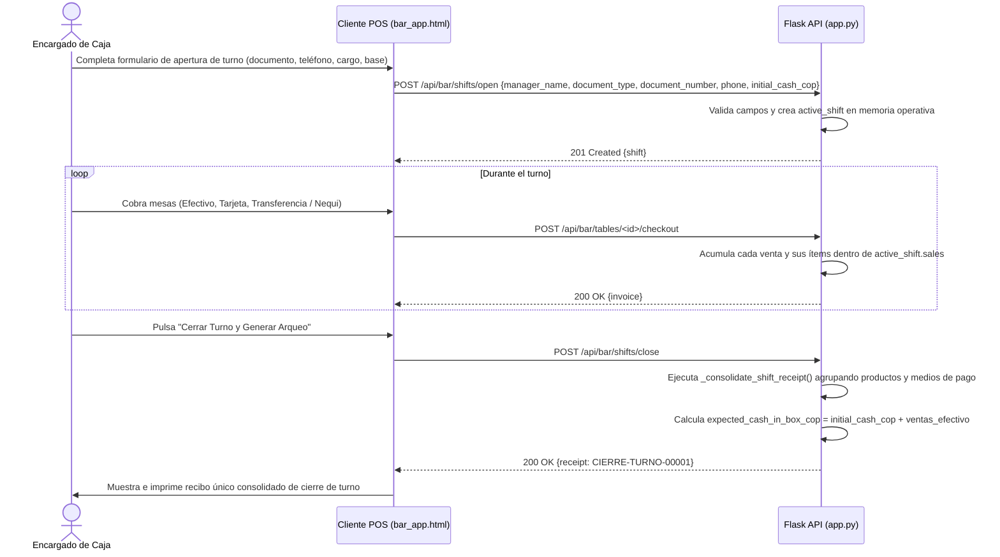

# Trabajo Escrito de Ingeniería de Software y Base de Datos — Proyecto Barrica POS

Este documento reúne todos los entregables formales del trabajo escrito del sistema **Barrica POS** (Sistema de Gestión, Inventario, Turnos y Punto de Venta para Bares conectado a **MySQL 8.0** con backend en **Python / Flask**, interfaz web/móvil en **HTML5/CSS3/JS** con **Modo Demo Local JSON** y aplicación nativa de escritorio en **C# WinForms**).

---

## Índice General

1. [Diagrama Entidad-Relación (DER)](#1-diagrama-entidad-relación-der)
2. [Modelo Relacional (MR)](#2-modelo-relacional-mr)
3. [Diccionario de Datos](#3-diccionario-de-datos)
4. [Diagramas UML](#4-diagramas-uml)
   - [4.1 Diagrama de Casos de Uso](#41-diagrama-de-casos-de-uso)
   - [4.2 Diagrama de Clases](#42-diagrama-de-clases)
   - [4.3 Diagramas de Actividades](#43-diagramas-de-actividades)
   - [4.4 Diagramas de Secuencias](#44-diagramas-de-secuencias)
5. [Documentación de Casos de Uso (Fichas Técnicas)](#5-documentación-de-casos-de-uso-fichas-técnicas)
6. [Scripts de la Base de Datos](#6-scripts-de-la-base-de-datos)
7. [Backup de Base de Datos](#7-backup-de-base-de-datos)
8. [Mockups de la Aplicación](#8-mockups-de-la-aplicación)
9. [Enlace de Código Fuente de la Aplicación en un Repositorio de GIT](#9-enlace-de-código-fuente-de-la-aplicación-en-un-repositorio-de-git)

---

## 1. Diagrama Entidad-Relación (DER)

El modelo de datos de **Barrica POS** está compuesto por **8 entidades relacionales en MySQL** que garantizan la trazabilidad de usuarios, sesiones por pestaña, planes de suscripción, intentos de autenticación, catálogo de productos con bodega de reserva, mesas del salón, comandas activas e historial de ventas cerradas.


### Descripción de Relaciones del DER
- **`USERS` 1:N `SESSIONS`**: Un usuario registrado puede iniciar múltiples sesiones a lo largo del tiempo. Cada sesión pertenece exactamente a un usuario (`ON DELETE CASCADE`).
- **`USERS` 1:N `SUBSCRIPTIONS`**: Un usuario puede registrar una o varias suscripciones (`basico`, `pro`, `multilocal`). El rol `administrador` goza de acceso vitalicio al plan `multilocal` validado por regla de negocio.
- **`BAR_TABLES` 1:N `TABLE_ORDERS`**: Una mesa abierta puede tener múltiples líneas de comanda activas. Al cobrar o eliminar la mesa, sus líneas activas se limpian (`ON DELETE CASCADE`).
- **`PRODUCTS` 1:N `TABLE_ORDERS`**: Un producto del inventario puede aparecer en múltiples pedidos de distintas mesas. Si un producto se elimina del catálogo, la línea conserva `product_name` y `unit_price_cop` históricos (`ON DELETE SET NULL`).
- **`AUTH_ATTEMPTS`** y **`SALES`**: Entidades independientes de seguridad (rate-limiting por hash SHA-256 de `correo+IP`) y libro histórico inmutable de ventas facturadas.

---

## 2. Modelo Relacional (MR)

### 2.1 Esquema Relacional Formal

Notación relacional con llaves primarias (**PK**), llaves foráneas (*FK*) y restricciones de unicidad (**UQ**):

1. **USERS** (**id** `PK`, full_name, email `UQ`, password_hash, role, created_at)
2. **SESSIONS** (**token_hash** `PK`, *user_id* `FK → USERS.id ON DELETE CASCADE`, role, expires_at, created_at)
3. **SUBSCRIPTIONS** (**id** `PK`, *user_id* `FK → USERS.id ON DELETE CASCADE`, plan_id, status, payment_reference `UQ`, starts_at, expires_at, created_at)
4. **AUTH_ATTEMPTS** (**key_hash** `PK`, attempts, window_started_at, last_attempt_at)
5. **PRODUCTS** (**id** `PK`, name, category, price_cop, stock, min_stock, reserve_stock, image_url, created_at)
6. **BAR_TABLES** (**id** `PK`, table_number `UQ`, label, capacity, status)
7. **TABLE_ORDERS** (**id** `PK`, *table_id* `FK → BAR_TABLES.id ON DELETE CASCADE`, *product_id* `FK → PRODUCTS.id ON DELETE SET NULL`, product_name, quantity, unit_price_cop, created_at)
8. **SALES** (**id** `PK`, table_label, items_summary, total_cop, payment_method, created_at)

### 2.2 Matriz de Integridad Referencial y Restricciones

| Tabla Origen | Columna Foránea (`FK`) | Tabla Destino (`PK`) | Regla `ON DELETE` | Propósito en el Negocio |
| :--- | :--- | :--- | :---: | :--- |
| `sessions` | `user_id` | `users(id)` | `CASCADE` | Revoca automáticamente todas las sesiones si se elimina el usuario. |
| `subscriptions` | `user_id` | `users(id)` | `CASCADE` | Elimina el historial de planes asociados si se borra la cuenta titular. |
| `table_orders` | `table_id` | `bar_tables(id)` | `CASCADE` | Limpia las órdenes abiertas si una mesa es eliminada del salón. |
| `table_orders` | `product_id` | `products(id)` | `SET NULL` | Mantiene el ítem en la cuenta abierta usando `product_name` y `unit_price_cop` aunque el producto se borre del catálogo. |

---

## 3. Diccionario de Datos

### 3.1 Tabla `users` (Usuarios del sistema y sus roles)

| Campo | Tipo de Dato | Nulo | Clave | Por Defecto | Descripción |
| :--- | :--- | :---: | :---: | :--- | :--- |
| `id` | `BIGINT UNSIGNED` | NO | `PK`, `AI` | — | Identificador único autoincremental del usuario. |
| `full_name` | `VARCHAR(120)` | NO | — | — | Nombre completo del integrante (validado sin dígitos numéricos). |
| `email` | `VARCHAR(254)` | NO | `UNIQUE` | — | Correo electrónico único normalizado en minúsculas. |
| `password_hash` | `VARCHAR(100)` | NO | — | — | Hash criptográfico `bcrypt` (12 rondas de costo). |
| `role` | `VARCHAR(20)` | NO | — | `'vendedor'` | Rol de autorización: `'administrador'` o `'vendedor'`. |
| `created_at` | `TIMESTAMP` | NO | — | `CURRENT_TIMESTAMP` | Fecha y hora UTC de creación de la cuenta. |

### 3.2 Tabla `sessions` (Sesiones activas e historial de accesos)

| Campo | Tipo de Dato | Nulo | Clave | Por Defecto | Descripción |
| :--- | :--- | :---: | :---: | :--- | :--- |
| `token_hash` | `CHAR(64)` | NO | `PK` | — | Hash SHA-256 en ASCII del token de sesión aleatorio emitido al cliente. |
| `user_id` | `BIGINT UNSIGNED` | NO | `FK`, `INDEX` | — | Referencia al propietario de la sesión en `users(id)`. |
| `role` | `VARCHAR(20)` | NO | — | `'vendedor'` | Rol efectivo con el que se autenticó la sesión. |
| `expires_at` | `DATETIME` | NO | `INDEX` | — | Fecha y hora UTC de expiración del token (12 horas operativas). |
| `created_at` | `TIMESTAMP` | NO | — | `CURRENT_TIMESTAMP` | Fecha y hora UTC del inicio de sesión. |

### 3.3 Tabla `subscriptions` (Planes y control de acceso al POS)

| Campo | Tipo de Dato | Nulo | Clave | Por Defecto | Descripción |
| :--- | :--- | :---: | :---: | :--- | :--- |
| `id` | `BIGINT UNSIGNED` | NO | `PK`, `AI` | — | Identificador único de la suscripción. |
| `user_id` | `BIGINT UNSIGNED` | NO | `FK`, `INDEX` | — | Usuario titular de la suscripción (`users.id`). |
| `plan_id` | `VARCHAR(30)` | NO | — | — | Código del plan contratado (`basico`, `pro`, `multilocal`). |
| `status` | `VARCHAR(20)` | NO | `INDEX` | `'pending'` | Estado de vigencia (`active`, `test_active`, `pending`, `expired`). |
| `payment_reference` | `VARCHAR(80)` | SÍ | `UNIQUE` | `NULL` | Referencia única del recibo o transacción de pago. |
| `starts_at` | `DATETIME` | NO | — | — | Fecha y hora UTC de inicio de cobertura del plan. |
| `expires_at` | `DATETIME` | NO | `INDEX` | — | Fecha y hora UTC de corte/expiración del plan. |
| `created_at` | `TIMESTAMP` | NO | — | `CURRENT_TIMESTAMP` | Marca temporal de creación del registro. |

### 3.4 Tabla `auth_attempts` (Protección contra ataques de fuerza bruta)

| Campo | Tipo de Dato | Nulo | Clave | Por Defecto | Descripción |
| :--- | :--- | :---: | :---: | :--- | :--- |
| `key_hash` | `CHAR(64)` | NO | `PK` | — | Hash SHA-256 del par `email:ip_cliente`. |
| `attempts` | `SMALLINT UNSIGNED` | NO | — | `0` | Contador de intentos fallidos dentro de la ventana de 15 minutos (máx. 5). |
| `window_started_at` | `DATETIME` | NO | — | — | Inicio de la ventana temporal de evaluación. |
| `last_attempt_at` | `DATETIME` | NO | `INDEX` | — | Fecha y hora UTC del último intento fallido registrado. |

### 3.5 Tabla `products` (Inventario de licores, carta y bodega de reserva)

| Campo | Tipo de Dato | Nulo | Clave | Por Defecto | Descripción |
| :--- | :--- | :---: | :---: | :--- | :--- |
| `id` | `INT UNSIGNED` | NO | `PK`, `AI` | — | Identificador único del producto en la carta. |
| `name` | `VARCHAR(120)` | NO | — | — | Nombre comercial de la bebida, botella, cóctel o comida. |
| `category` | `VARCHAR(60)` | NO | — | `'Licores'` | Categoría (`Licores`, `Cócteles`, `Cervezas`, `Comida`, `Sin alcohol`). |
| `price_cop` | `INT UNSIGNED` | NO | — | — | Precio unitario de venta en pesos colombianos (COP). |
| `stock` | `INT` | NO | — | `0` | Unidades disponibles para venta inmediata en barra. |
| `min_stock` | `INT` | NO | — | `5` | Punto de reorden para encender alerta visual de agotamiento. |
| `reserve_stock` | `INT` | NO | — | `0` | Unidades almacenadas en la bodega interna de reserva. |
| `image_url` | `VARCHAR(500)` | SÍ | — | `NULL` | Ruta estática o URL de la fotografía optimizada del producto. |
| `created_at` | `TIMESTAMP` | NO | — | `CURRENT_TIMESTAMP` | Fecha y hora UTC de incorporación al catálogo. |

### 3.6 Tabla `bar_tables` (Mesas y puestos de barra del salón)

| Campo | Tipo de Dato | Nulo | Clave | Por Defecto | Descripción |
| :--- | :--- | :---: | :---: | :--- | :--- |
| `id` | `INT UNSIGNED` | NO | `PK`, `AI` | — | Identificador interno de la mesa. |
| `table_number` | `INT UNSIGNED` | NO | `UNIQUE` | — | Número único visible de la mesa o puesto en el mapa del local. |
| `label` | `VARCHAR(60)` | NO | — | — | Nombre descriptivo y zona (ej. `Mesa 4 · Terraza`, `Mesa 6 · VIP`). |
| `capacity` | `SMALLINT UNSIGNED` | NO | — | `4` | Capacidad de personas sentadas en la mesa. |
| `status` | `VARCHAR(20)` | NO | — | `'libre'` | Estado operativo en tiempo real (`libre`, `ocupada`, `por_cobrar`). |

### 3.7 Tabla `table_orders` (Comandas y consumos activos por mesa)

| Campo | Tipo de Dato | Nulo | Clave | Por Defecto | Descripción |
| :--- | :--- | :---: | :---: | :--- | :--- |
| `id` | `BIGINT UNSIGNED` | NO | `PK`, `AI` | — | Identificador único de la línea de pedido. |
| `table_id` | `INT UNSIGNED` | NO | `FK`, `INDEX` | — | Referencia a la mesa activa (`bar_tables.id`). |
| `product_id` | `INT UNSIGNED` | SÍ | `FK` | `NULL` | Referencia al producto descontado (`products.id`). |
| `product_name` | `VARCHAR(120)` | NO | — | — | Nombre congelado del producto en el instante de la comanda. |
| `quantity` | `INT UNSIGNED` | NO | — | `1` | Cantidad de unidades servidas en esa línea. |
| `unit_price_cop` | `INT UNSIGNED` | NO | — | — | Precio unitario en COP congelado al tomar el pedido. |
| `created_at` | `TIMESTAMP` | NO | — | `CURRENT_TIMESTAMP` | Hora exacta de solicitud del consumo. |

### 3.8 Tabla `sales` (Historial contable de ventas cobradas)

| Campo | Tipo de Dato | Nulo | Clave | Por Defecto | Descripción |
| :--- | :--- | :---: | :---: | :--- | :--- |
| `id` | `BIGINT UNSIGNED` | NO | `PK`, `AI` | — | Consecutivo único de la venta cerrada. |
| `table_label` | `VARCHAR(60)` | NO | — | — | Etiqueta de la mesa donde se efectuó el consumo. |
| `items_summary` | `VARCHAR(500)` | NO | — | — | Resumen textual de los productos y cantidades facturadas. |
| `total_cop` | `INT UNSIGNED` | NO | — | — | Monto total pagado en pesos colombianos (COP). |
| `payment_method` | `VARCHAR(40)` | NO | — | `'Efectivo'` | Medio de pago (`Efectivo`, `Tarjeta`, `Transferencia / Nequi`). |
| `created_at` | `TIMESTAMP` | NO | `INDEX` | `CURRENT_TIMESTAMP` | Fecha y hora UTC del cierre de cuenta. |

### 3.9 Entidades Operativas en Memoria / Almacenamiento JSON (`shifts`, `invoices`, `clients`)

Además de las 8 tablas MySQL, el sistema gestiona tres estructuras JSON para control de caja y CRM local:
- **Turno de Caja (`shift` / `CIERRE-TURNO-XXXXX`)**: `id`, `folio`, `opened_at`, `closed_at`, `manager` (`name`, `document_type`, `document_number`, `phone`, `email`, `position`, `notes`), `initial_cash_cop`, `products_sold`, `payment_breakdown`, `total_sales_cop`, `expected_cash_in_box_cop`.
- **Factura Fantasma (`invoice` / `FAC-FANTASMA-XXXXX`)**: `id`, `folio`, `date`, `table_label`, `client`, `client_info`, `items`, `detail`, `payment_method`, `cash_received`, `cash_change`, `total`, `cashier`, `shift_id`.
- **Cliente CRM (`client`)**: `id`, `name`, `email`, `phone`, `address`, `city`, `country`, `created_at`.

---

## 4. Diagramas UML

### 4.1 Diagrama de Casos de Uso



---

### 4.2 Diagrama de Clases



---

### 4.3 Diagramas de Actividades

#### 4.3.1 Flujo de Login Obligatorio, Verificación de Suscripción (Paywall) y Acceso por Rol



#### 4.3.2 Flujo Operativo de Turno de Caja, Pedido en Mesa, Cobro y Cierre Consolidado



---

### 4.4 Diagramas de Secuencias

#### 4.4.1 Secuencia de Login con Paywall, Toma de Pedido y Cobro con Factura Fantasma



#### 4.4.2 Secuencia de Apertura y Cierre de Turno con Recibo Consolidado



---

## 5. Documentación de Casos de Uso (Fichas Técnicas)

### CU-01: Iniciar Sesión Obligatoria y Validar Suscripción por Rol

| Atributo | Especificación |
| :--- | :--- |
| **Código** | `CU-01` |
| **Nombre** | Iniciar sesión obligatoria por rol y validar acceso al POS |
| **Actores** | Administrador, Vendedor |
| **Descripción** | El usuario se autentica con correo y contraseña eligiendo su perfil operativo. El servidor verifica credenciales, comprueba que no exista escalamiento de privilegios y valida la suscripción activa antes de abrir el POS. |
| **Precondiciones** | El usuario debe existir previamente en la tabla `users` (el login nunca crea cuentas nuevas). |
| **Flujo Normal** | 1. El actor selecciona el perfil (`Vendedor` o `Administrador`) e introduce su correo y contraseña.<br>2. El cliente envía `POST /api/auth/login` con `purpose: "pos"`.<br>3. El sistema verifica que la combinación `email:ip` no supere 5 intentos fallidos en 15 minutos.<br>4. El sistema valida el hash `bcrypt` de la contraseña y confirma que el rol solicitado coincida con el rol en base de datos.<br>5. Si es `administrador`, recibe derecho vitalicio al plan `Multi-local`; si es `vendedor`, el sistema verifica un registro vigente en `subscriptions`.<br>6. Se registra el hash SHA-256 del token en `sessions` y el cliente guarda el token `Bearer` en `sessionStorage`. |
| **Flujos Alternativos** | - **4a. Credenciales inválidas o correo inexistente:** Se incrementa `auth_attempts` y se responde HTTP `401`.<br>- **4b. Vendedor intenta entrar como Administrador:** Se rechaza con HTTP `403`.<br>- **5a. Vendedor sin suscripción activa:** Se responde HTTP `402 Payment Required` (`subscription_required: true`) y se redirige al checkout de planes. |
| **Postcondiciones** | Sesión activa aislada en la pestaña actual y panel POS habilitado según los permisos del rol. |

### CU-02: Abrir y Cerrar Turno de Caja con Recibo Único Consolidado

| Atributo | Especificación |
| :--- | :--- |
| **Código** | `CU-02` |
| **Nombre** | Abrir y cerrar turno de caja con arqueo consolidado |
| **Actores** | Administrador, Vendedor (Encargado de Caja) |
| **Descripción** | Registra formalmente al responsable de la caja al iniciar la jornada y emite un único comprobante consolidado de cierre con todos los productos vendidos y el arqueo financiero del turno. |
| **Precondiciones** | Sesión POS autenticada y ningún otro turno abierto simultáneamente (`active_shift == None`). |
| **Flujo Normal** | 1. El encargado abre el módulo **Turnos** y diligencia: nombre completo, tipo y número de documento (`CC`, `CE`, `NIT`, `TI`, `PASAPORTE`), teléfono, correo, cargo y base inicial en efectivo.<br>2. El sistema valida los datos (`POST /api/bar/shifts/open`) e inicia el turno activo.<br>3. Todos los cobros de mesas realizados durante el turno se vinculan automáticamente al turno activo.<br>4. Al finalizar la jornada, el encargado pulsa **Cerrar Turno** (`POST /api/bar/shifts/close`).<br>5. El sistema agrupa todas las ventas por producto y por método de pago, suma la base inicial más el efectivo recaudado y emite el recibo único `CIERRE-TURNO-XXXXX`. |
| **Flujos Alternativos** | - **2a. Ya existe un turno abierto:** El servidor responde HTTP `409 Conflict` indicando que debe cerrarse el turno vigente antes de abrir otro.<br>- **4a. Intento de cierre sin turno activo:** El servidor responde HTTP `400`. |
| **Postcondiciones** | Turno cerrado, archivado en `closed_shifts` y recibo consolidado listo para impresión o descarga. |

### CU-03: Tomar Pedido en Mesa con Descuento Automático de Stock

| Atributo | Especificación |
| :--- | :--- |
| **Código** | `CU-03` |
| **Nombre** | Registrar consumo en mesa y descontar inventario en tiempo real |
| **Actores** | Administrador, Vendedor |
| **Descripción** | Asigna bebidas o platos a una mesa del salón descontando inmediatamente las unidades del stock disponible en barra. |
| **Precondiciones** | Sesión POS activa, mesa existente en `bar_tables` y producto con `stock >= cantidad`. |
| **Flujo Normal** | 1. El actor selecciona una mesa en el mapa del salón.<br>2. Filtra o elige un producto de la carta e indica la cantidad.<br>3. Envía `POST /api/bar/tables/<id>/orders`.<br>4. El servidor bloquea/verifica el stock actual del producto en `products`.<br>5. Si la mesa ya tenía ese mismo producto al mismo precio, incrementa `quantity` en `table_orders`; de lo contrario inserta una nueva fila.<br>6. Resta `quantity` de `products.stock` y actualiza `bar_tables.status = 'ocupada'`. |
| **Flujos Alternativos** | - **4a. Stock insuficiente:** El servidor aborta la transacción y devuelve HTTP `400` informando las unidades disponibles.<br>- **6a. Eliminación de ítem (`DELETE /api/bar/orders/<id>`):** Si se cancela un ítem antes de cobrar, el servidor devuelve las unidades a `products.stock` y, si la mesa queda sin consumos, la regresa a estado `'libre'`. |
| **Postcondiciones** | Comanda actualizada en `table_orders`, stock descontado en `products` y alerta visual si `stock <= min_stock`. |

### CU-04: Dividir Cuenta, Asociar Cliente CRM y Cobrar Mesa (Factura Fantasma)

| Atributo | Especificación |
| :--- | :--- |
| **Código** | `CU-04` |
| **Nombre** | Liquidar cuenta de mesa, registrar venta y emitir factura fantasma |
| **Actores** | Administrador, Vendedor |
| **Descripción** | Calcula el total de la mesa, permite dividir la cuenta entre varios comensales, calcula el cambio en efectivo, asocia un cliente del CRM y cierra la venta en MySQL generando su comprobante. |
| **Precondiciones** | Mesa con al menos un pedido activo en `table_orders`. |
| **Flujo Normal** | 1. El actor selecciona la mesa ocupada o por cobrar.<br>2. Opcionalmente indica el número de personas para dividir la cuenta en partes iguales y digita el efectivo recibido para visualizar las vueltas.<br>3. Selecciona un cliente registrado en el CRM (o deja `Consumidor final`) y elige el medio de pago (`Efectivo`, `Tarjeta`, `Transferencia / Nequi`).<br>4. Pulsa **Cobrar y liberar mesa** (`POST /api/bar/tables/<id>/checkout`).<br>5. El servidor inserta la venta en `sales`, elimina los registros de `table_orders` de esa mesa y cambia `bar_tables.status` a `'libre'`.<br>6. El sistema genera la factura fantasma `FAC-FANTASMA-XXXXX` con el detalle de ítems, cajero, cliente y cambio. |
| **Flujos Alternativos** | - **4a. Mesa sin consumos:** El servidor rechaza el cobro con HTTP `400` (`Esta mesa no tiene consumos por cobrar`). |
| **Postcondiciones** | Venta persistida en `sales`, factura `FAC-FANTASMA` registrada en el historial administrativo y mesa disponible para nuevos clientes. |

### CU-05: Administrar Inventario MySQL y Bodega de Reserva

| Atributo | Especificación |
| :--- | :--- |
| **Código** | `CU-05` |
| **Nombre** | Crear productos, ajustar existencias y trasladar desde bodega de reserva |
| **Actores** | Administrador |
| **Descripción** | Permite mantener el catálogo de productos del bar, sus precios, fotografía, stock en barra y unidades en bodega de reserva. |
| **Precondiciones** | Sesión activa con rol `administrador`. |
| **Flujo Normal** | 1. El administrador abre la pestaña **Inventario MySQL**.<br>2. Para crear un ítem (`POST /api/bar/products`), ingresa nombre, categoría, precio COP, stock inicial, stock mínimo, stock en reserva y URL de imagen.<br>3. Para ajustar existencias rápidas en barra (`POST /api/bar/products/<id>/stock`), utiliza los controles `-1`, `+1` o `+10`.<br>4. Para abastecer la barra desde la bodega interna (`POST /api/bar/products/<id>/reserve`), indica las unidades a trasladar: el sistema resta de `reserve_stock` y suma a `stock` en una sola transacción. |
| **Flujos Alternativos** | - **1a. Usuario con rol Vendedor:** Solo visualiza la carta en modo lectura; cualquier petición de escritura recibe HTTP `403`.<br>- **4a. Unidades solicitadas superan `reserve_stock`:** Se rechaza con HTTP `400` informando las unidades disponibles en reserva. |
| **Postcondiciones** | Catálogo y existencias de barra/bodega actualizados en tiempo real para todas las terminales conectadas. |

### CU-06: Gestionar CRM de Clientes con Clasificación Imprimible por País

| Atributo | Especificación |
| :--- | :--- |
| **Código** | `CU-06` |
| **Nombre** | Registrar clientes, clasificarlos por país e imprimir listado o facturas |
| **Actores** | Administrador, Vendedor |
| **Descripción** | Administra el directorio de clientes frecuentes del bar y permite filtrarlos e imprimir reportes agrupados por país de origen, así como consultar facturas fantasma (solo Administrador). |
| **Precondiciones** | Sesión activa en la aplicación operativa (`bar_app.html`). |
| **Flujo Normal** | 1. El actor accede a la sección **Clientes**.<br>2. Registra nombre completo, correo electrónico, teléfono, dirección, ciudad y país.<br>3. Filtra el directorio por país o término de búsqueda y genera la vista imprimible de clientes clasificados por país.<br>4. Si tiene rol **Administrador**, accede a la pestaña **Facturas** para auditar o imprimir cualquier comprobante `FAC-FANTASMA-XXXXX`. |
| **Flujos Alternativos** | - **2a. Datos obligatorios faltantes (nombre o país):** El formulario solicita completar los campos requeridos antes de guardar. |
| **Postcondiciones** | Cliente disponible en el selector de caja para próximos cobros y reportes listos para impresión. |

### CU-07: Auditar Usuarios, Sesiones, Ventas por Periodo y Asignar Roles

| Atributo | Especificación |
| :--- | :--- |
| **Código** | `CU-07` |
| **Nombre** | Administrar roles del equipo, auditar sesiones y consultar KPIs de ventas |
| **Actores** | Administrador |
| **Descripción** | Supervisa las cuentas registradas, las sesiones activas o expiradas, las métricas de ingresos (día, semana, mes, año) y promueve o degrada roles de usuario. |
| **Precondiciones** | Sesión activa con rol `administrador`. |
| **Flujo Normal** | 1. El administrador abre la pestaña **Administración** (`GET /api/bar/dashboard`).<br>2. Visualiza el resumen financiero (`today_cop`, `week_cop`, `month_cop`, `year_cop`), la lista de usuarios, sesiones y últimas ventas.<br>3. Para cambiar el rol de un usuario (`POST /api/bar/users/<id>/role`), pulsa el botón de cambio entre `administrador` y `vendedor`.<br>4. El servidor actualiza `users.role` y sincroniza `sessions.role` de ese usuario. |
| **Flujos Alternativos** | - **3a. Intento de quitar el rol al único administrador del sistema:** El servidor cuenta los administradores restantes y bloquea la operación con HTTP `400` (`Debe existir al menos un administrador en el sistema`). |
| **Postcondiciones** | Rol actualizado inmediatamente en `users` y `sessions`, preservando al menos un administrador activo. |

### CU-08: Operar en Modo Demo Local JSON con Respaldo Portable

| Atributo | Especificación |
| :--- | :--- |
| **Código** | `CU-08` |
| **Nombre** | Ejecutar el sistema sin MySQL mediante almacenamiento JSON local |
| **Actores** | Administrador, Vendedor |
| **Descripción** | Permite evaluar o utilizar todas las funciones del POS en un navegador local sin conexión a MySQL, incluyendo exportación y restauración de copias `.json`. |
| **Precondiciones** | Ejecutar `iniciar_demo_local_json.bat` o abrir `/bar_app?mode=local`. |
| **Flujo Normal** | 1. El usuario inicia el modo demo local JSON.<br>2. El sistema inicializa el almacén local JSON con inventario semilla, mesas y la cuenta `admin@gmail.com` provista de rol Administrador y plan Multi-local vitalicio.<br>3. Todas las operaciones de mesas, pedidos, cobros, turnos, clientes e inventario se leen y escriben en el almacenamiento JSON del navegador.<br>4. Desde **Ajustes**, el usuario puede descargar un archivo de respaldo `.json` o restaurar una copia previa. |
| **Flujos Alternativos** | - **2a. Ya existían datos JSON previos en el navegador:** El sistema conserva intactos las ventas, mesas e inventario previos e incorpora la cuenta administradora sin sobrescribirlos. |
| **Postcondiciones** | Operación autónoma local persistida en el navegador y exportable a archivo `.json`. |

---

## 6. Scripts de la Base de Datos

- **Esquema principal DDL:** [`database/schema.sql`](../database/schema.sql)
- **Ejecutor automático de esquema y migraciones en Aiven MySQL:** [`database/run_schema.py`](../database/run_schema.py)
- **Gestor CLI de usuarios, sesiones y restablecimiento seguro de administrador:** [`conection.py`](../conection.py)

### 6.1 Script DDL Principal (`database/schema.sql`)

```sql
CREATE DATABASE IF NOT EXISTS barika_db;
USE barika_db;

CREATE TABLE IF NOT EXISTS users (
    id BIGINT UNSIGNED NOT NULL AUTO_INCREMENT,
    full_name VARCHAR(120) NOT NULL,
    email VARCHAR(254) NOT NULL,
    password_hash VARCHAR(100) NOT NULL,
    role VARCHAR(20) NOT NULL DEFAULT 'vendedor',
    created_at TIMESTAMP NOT NULL DEFAULT CURRENT_TIMESTAMP,
    PRIMARY KEY (id),
    UNIQUE KEY uq_users_email (email)
) ENGINE=InnoDB DEFAULT CHARSET=utf8mb4 COLLATE=utf8mb4_unicode_ci;

CREATE TABLE IF NOT EXISTS sessions (
    token_hash CHAR(64) CHARACTER SET ascii COLLATE ascii_bin NOT NULL,
    user_id BIGINT UNSIGNED NOT NULL,
    role VARCHAR(20) NOT NULL DEFAULT 'vendedor',
    expires_at DATETIME NOT NULL,
    created_at TIMESTAMP NOT NULL DEFAULT CURRENT_TIMESTAMP,
    PRIMARY KEY (token_hash),
    KEY idx_sessions_user_id (user_id),
    KEY idx_sessions_expires_at (expires_at),
    CONSTRAINT fk_sessions_user
        FOREIGN KEY (user_id) REFERENCES users (id) ON DELETE CASCADE
) ENGINE=InnoDB DEFAULT CHARSET=utf8mb4 COLLATE=utf8mb4_unicode_ci;

CREATE TABLE IF NOT EXISTS auth_attempts (
    key_hash CHAR(64) CHARACTER SET ascii COLLATE ascii_bin NOT NULL,
    attempts SMALLINT UNSIGNED NOT NULL DEFAULT 0,
    window_started_at DATETIME NOT NULL,
    last_attempt_at DATETIME NOT NULL,
    PRIMARY KEY (key_hash),
    KEY idx_auth_attempts_last_attempt_at (last_attempt_at)
) ENGINE=InnoDB DEFAULT CHARSET=utf8mb4 COLLATE=utf8mb4_unicode_ci;

CREATE TABLE IF NOT EXISTS products (
    id INT UNSIGNED NOT NULL AUTO_INCREMENT,
    name VARCHAR(120) NOT NULL,
    category VARCHAR(60) NOT NULL DEFAULT 'Licores',
    price_cop INT UNSIGNED NOT NULL,
    stock INT NOT NULL DEFAULT 0,
    min_stock INT NOT NULL DEFAULT 5,
    reserve_stock INT NOT NULL DEFAULT 0,
    image_url VARCHAR(500) NULL,
    created_at TIMESTAMP NOT NULL DEFAULT CURRENT_TIMESTAMP,
    PRIMARY KEY (id)
) ENGINE=InnoDB DEFAULT CHARSET=utf8mb4 COLLATE=utf8mb4_unicode_ci;

CREATE TABLE IF NOT EXISTS bar_tables (
    id INT UNSIGNED NOT NULL AUTO_INCREMENT,
    table_number INT UNSIGNED NOT NULL,
    label VARCHAR(60) NOT NULL,
    capacity SMALLINT UNSIGNED NOT NULL DEFAULT 4,
    status VARCHAR(20) NOT NULL DEFAULT 'libre',
    PRIMARY KEY (id),
    UNIQUE KEY uq_bar_tables_number (table_number)
) ENGINE=InnoDB DEFAULT CHARSET=utf8mb4 COLLATE=utf8mb4_unicode_ci;

CREATE TABLE IF NOT EXISTS table_orders (
    id BIGINT UNSIGNED NOT NULL AUTO_INCREMENT,
    table_id INT UNSIGNED NOT NULL,
    product_id INT UNSIGNED NULL,
    product_name VARCHAR(120) NOT NULL,
    quantity INT UNSIGNED NOT NULL DEFAULT 1,
    unit_price_cop INT UNSIGNED NOT NULL,
    created_at TIMESTAMP NOT NULL DEFAULT CURRENT_TIMESTAMP,
    PRIMARY KEY (id),
    KEY idx_table_orders_table_id (table_id),
    CONSTRAINT fk_table_orders_table
        FOREIGN KEY (table_id) REFERENCES bar_tables (id) ON DELETE CASCADE,
    CONSTRAINT fk_table_orders_product
        FOREIGN KEY (product_id) REFERENCES products (id) ON DELETE SET NULL
) ENGINE=InnoDB DEFAULT CHARSET=utf8mb4 COLLATE=utf8mb4_unicode_ci;

CREATE TABLE IF NOT EXISTS sales (
    id BIGINT UNSIGNED NOT NULL AUTO_INCREMENT,
    table_label VARCHAR(60) NOT NULL,
    items_summary VARCHAR(500) NOT NULL,
    total_cop INT UNSIGNED NOT NULL,
    payment_method VARCHAR(40) NOT NULL DEFAULT 'Efectivo',
    created_at TIMESTAMP NOT NULL DEFAULT CURRENT_TIMESTAMP,
    PRIMARY KEY (id),
    KEY idx_sales_created_at (created_at)
) ENGINE=InnoDB DEFAULT CHARSET=utf8mb4 COLLATE=utf8mb4_unicode_ci;

CREATE TABLE IF NOT EXISTS subscriptions (
    id BIGINT UNSIGNED NOT NULL AUTO_INCREMENT,
    user_id BIGINT UNSIGNED NOT NULL,
    plan_id VARCHAR(30) NOT NULL,
    status VARCHAR(20) NOT NULL DEFAULT 'pending',
    payment_reference VARCHAR(80) NULL,
    starts_at DATETIME NOT NULL,
    expires_at DATETIME NOT NULL,
    created_at TIMESTAMP NOT NULL DEFAULT CURRENT_TIMESTAMP,
    PRIMARY KEY (id),
    KEY idx_subscriptions_user_status_expiry (user_id, status, expires_at),
    UNIQUE KEY uq_subscriptions_payment_reference (payment_reference),
    CONSTRAINT fk_subscriptions_user FOREIGN KEY (user_id) REFERENCES users (id) ON DELETE CASCADE
) ENGINE=InnoDB DEFAULT CHARSET=utf8mb4 COLLATE=utf8mb4_unicode_ci;
```

---

## 7. Backup de Base de Datos

Archivo fuente: [`database/backup_barrica.sql`](../database/backup_barrica.sql)

```sql
-- ============================================================================
-- BACKUP DE BASE DE DATOS MYSQL - PROYECTO BARRICA (SISTEMA POS / CRM DE BAR)
-- Motor: MySQL 8.0 (InnoDB, utf8mb4_unicode_ci)
-- ============================================================================
USE barika_db;
SET NAMES utf8mb4;
SET FOREIGN_KEY_CHECKS = 0;

CREATE TABLE IF NOT EXISTS `users` (
    `id` BIGINT UNSIGNED NOT NULL AUTO_INCREMENT,
    `full_name` VARCHAR(120) NOT NULL,
    `email` VARCHAR(254) NOT NULL,
    `password_hash` VARCHAR(100) NOT NULL,
    `role` VARCHAR(20) NOT NULL DEFAULT 'vendedor',
    `created_at` TIMESTAMP NOT NULL DEFAULT CURRENT_TIMESTAMP,
    PRIMARY KEY (`id`),
    UNIQUE KEY `uq_users_email` (`email`)
) ENGINE=InnoDB DEFAULT CHARSET=utf8mb4 COLLATE=utf8mb4_unicode_ci;

CREATE TABLE IF NOT EXISTS `sessions` (
    `token_hash` CHAR(64) CHARACTER SET ascii COLLATE ascii_bin NOT NULL,
    `user_id` BIGINT UNSIGNED NOT NULL,
    `role` VARCHAR(20) NOT NULL DEFAULT 'vendedor',
    `expires_at` DATETIME NOT NULL,
    `created_at` TIMESTAMP NOT NULL DEFAULT CURRENT_TIMESTAMP,
    PRIMARY KEY (`token_hash`),
    KEY `idx_sessions_user_id` (`user_id`),
    KEY `idx_sessions_expires_at` (`expires_at`),
    CONSTRAINT `fk_sessions_user`
        FOREIGN KEY (`user_id`) REFERENCES `users` (`id`) ON DELETE CASCADE
) ENGINE=InnoDB DEFAULT CHARSET=utf8mb4 COLLATE=utf8mb4_unicode_ci;

CREATE TABLE IF NOT EXISTS `auth_attempts` (
    `key_hash` CHAR(64) CHARACTER SET ascii COLLATE ascii_bin NOT NULL,
    `attempts` SMALLINT UNSIGNED NOT NULL DEFAULT 0,
    `window_started_at` DATETIME NOT NULL,
    `last_attempt_at` DATETIME NOT NULL,
    PRIMARY KEY (`key_hash`),
    KEY `idx_auth_attempts_last_attempt_at` (`last_attempt_at`)
) ENGINE=InnoDB DEFAULT CHARSET=utf8mb4 COLLATE=utf8mb4_unicode_ci;

CREATE TABLE IF NOT EXISTS `products` (
    `id` INT UNSIGNED NOT NULL AUTO_INCREMENT,
    `name` VARCHAR(120) NOT NULL,
    `category` VARCHAR(60) NOT NULL DEFAULT 'Licores',
    `price_cop` INT UNSIGNED NOT NULL,
    `stock` INT NOT NULL DEFAULT 0,
    `min_stock` INT NOT NULL DEFAULT 5,
    `reserve_stock` INT NOT NULL DEFAULT 0,
    `image_url` VARCHAR(500) NULL,
    `created_at` TIMESTAMP NOT NULL DEFAULT CURRENT_TIMESTAMP,
    PRIMARY KEY (`id`)
) ENGINE=InnoDB DEFAULT CHARSET=utf8mb4 COLLATE=utf8mb4_unicode_ci;

CREATE TABLE IF NOT EXISTS `bar_tables` (
    `id` INT UNSIGNED NOT NULL AUTO_INCREMENT,
    `table_number` INT UNSIGNED NOT NULL,
    `label` VARCHAR(60) NOT NULL,
    `capacity` SMALLINT UNSIGNED NOT NULL DEFAULT 4,
    `status` VARCHAR(20) NOT NULL DEFAULT 'libre',
    PRIMARY KEY (`id`),
    UNIQUE KEY `uq_bar_tables_number` (`table_number`)
) ENGINE=InnoDB DEFAULT CHARSET=utf8mb4 COLLATE=utf8mb4_unicode_ci;

CREATE TABLE IF NOT EXISTS `table_orders` (
    `id` BIGINT UNSIGNED NOT NULL AUTO_INCREMENT,
    `table_id` INT UNSIGNED NOT NULL,
    `product_id` INT UNSIGNED NULL,
    `product_name` VARCHAR(120) NOT NULL,
    `quantity` INT UNSIGNED NOT NULL DEFAULT 1,
    `unit_price_cop` INT UNSIGNED NOT NULL,
    `created_at` TIMESTAMP NOT NULL DEFAULT CURRENT_TIMESTAMP,
    PRIMARY KEY (`id`),
    KEY `idx_table_orders_table_id` (`table_id`),
    CONSTRAINT `fk_table_orders_table`
        FOREIGN KEY (`table_id`) REFERENCES `bar_tables` (`id`) ON DELETE CASCADE,
    CONSTRAINT `fk_table_orders_product`
        FOREIGN KEY (`product_id`) REFERENCES `products` (`id`) ON DELETE SET NULL
) ENGINE=InnoDB DEFAULT CHARSET=utf8mb4 COLLATE=utf8mb4_unicode_ci;

CREATE TABLE IF NOT EXISTS `sales` (
    `id` BIGINT UNSIGNED NOT NULL AUTO_INCREMENT,
    `table_label` VARCHAR(60) NOT NULL,
    `items_summary` VARCHAR(500) NOT NULL,
    `total_cop` INT UNSIGNED NOT NULL,
    `payment_method` VARCHAR(40) NOT NULL DEFAULT 'Efectivo',
    `created_at` TIMESTAMP NOT NULL DEFAULT CURRENT_TIMESTAMP,
    PRIMARY KEY (`id`),
    KEY `idx_sales_created_at` (`created_at`)
) ENGINE=InnoDB DEFAULT CHARSET=utf8mb4 COLLATE=utf8mb4_unicode_ci;

CREATE TABLE IF NOT EXISTS `subscriptions` (
    `id` BIGINT UNSIGNED NOT NULL AUTO_INCREMENT,
    `user_id` BIGINT UNSIGNED NOT NULL,
    `plan_id` VARCHAR(30) NOT NULL,
    `status` VARCHAR(20) NOT NULL DEFAULT 'pending',
    `payment_reference` VARCHAR(80) NULL,
    `starts_at` DATETIME NOT NULL,
    `expires_at` DATETIME NOT NULL,
    `created_at` TIMESTAMP NOT NULL DEFAULT CURRENT_TIMESTAMP,
    PRIMARY KEY (`id`),
    KEY `idx_subscriptions_user_status_expiry` (`user_id`, `status`, `expires_at`),
    UNIQUE KEY `uq_subscriptions_payment_reference` (`payment_reference`),
    CONSTRAINT `fk_subscriptions_user`
        FOREIGN KEY (`user_id`) REFERENCES `users` (`id`) ON DELETE CASCADE
) ENGINE=InnoDB DEFAULT CHARSET=utf8mb4 COLLATE=utf8mb4_unicode_ci;

INSERT IGNORE INTO `bar_tables` (`id`, `table_number`, `label`, `capacity`, `status`) VALUES
(1, 1, 'Mesa 1 · Salón', 4, 'libre'),
(2, 2, 'Mesa 2 · Salón', 4, 'libre'),
(3, 3, 'Mesa 3 · Ventana', 2, 'libre'),
(4, 4, 'Mesa 4 · Terraza', 6, 'libre'),
(5, 5, 'Mesa 5 · Terraza', 4, 'libre'),
(6, 6, 'Mesa 6 · VIP', 8, 'libre'),
(7, 7, 'Barra 1 · Principal', 2, 'libre'),
(8, 8, 'Barra 2 · Principal', 2, 'libre');

INSERT IGNORE INTO `products` (`id`, `name`, `category`, `price_cop`, `stock`, `min_stock`) VALUES
(1, 'Negroni', 'Cócteles', 28000, 24, 5),
(2, 'Old Fashioned', 'Cócteles', 30000, 20, 5),
(3, 'Margarita Artesanal', 'Cócteles', 26000, 18, 5),
(4, 'Cerveza Club Colombia', 'Cervezas', 9000, 48, 12),
(5, 'Cerveza Artesanal IPA', 'Cervezas', 15000, 30, 8),
(6, 'Botella Ginebra Tanqueray', 'Licores', 165000, 3, 4),
(7, 'Botella Aguardiente Antioqueño', 'Licores', 85000, 10, 4),
(8, 'Tabla de Quesos y Madurados', 'Comida', 42000, 12, 3);

SET FOREIGN_KEY_CHECKS = 1;
```

---

## 8. Mockups de la Aplicación

### 8.1 Portal Web Principal, Mapa de Villavicencio y Planes (`Untitled-1.html`)

```text
+----------------------------------------------------------------------------------+
| BARRICA POS   [Funciones] [Planes] [Ubicación Villavicencio] [Descargas] [Login] |
+----------------------------------------------------------------------------------+
|  CONTROL TOTAL PARA TU BAR EN TIEMPO REAL                                        |
|  Mesas, comandas, inventario MySQL, turnos de caja y app nativa Windows/Móvil.   |
|  [ Abrir App Operativa POS ]   [ Descargar BarricaDesktop.exe ]                  |
+----------------------------------------------------------------------------------+
|  PLANES DE SUSCRIPCIÓN (USD / COP)                                               |
|  +-----------------------+  +-----------------------+  +-----------------------+ |
|  | PLAN BÁSICO           |  | PLAN PRO (Destacado)  |  | PLAN MULTI-LOCAL      | |
|  | $29 USD / $116.000 COP|  | $59 USD / $236.000 COP|  | $129 USD / $516.000   | |
|  | 1 barra · Mesas y POS |  | Inventario + Turnos   |  | Vitalicio para Admin  | |
|  | [ Elegir Básico ]     |  | [ Elegir Pro ]        |  | [ Elegir Multi-local ]| |
|  +-----------------------+  +-----------------------+  +-----------------------+ |
+----------------------------------------------------------------------------------+
|  UBICACIÓN Y RECOMENDACIONES · CORREDOR ECOLÓGICO DE VILLAVICENCIO               |
|  [ Mapa Interactivo Google Maps: Corredor Ecológico Villavicencio, Meta ]        |
|  Redes: [WhatsApp] [Instagram] [TikTok] [Gmail] [Facebook] [X]   (● Botón WA)    |
+----------------------------------------------------------------------------------+
```

### 8.2 Pantalla de Inicio de Sesión Obligatorio por Rol (`bar_app.html` / `BarricaDesktop.exe`)

```text
+------------------------------------------------------------------+
|  BARRICA · SISTEMA OPERATIVO DE BAR                              |
|  Elige tu perfil de trabajo e ingresa tus credenciales           |
|                                                                  |
|  +----------------------------+  +----------------------------+  |
|  | [▣ VENDEDOR]               |  | [◈ ADMINISTRADOR] (Activo) |  |
|  | Mesas, pedidos, turnos,    |  | Inventario, bodega, roles, |  |
|  | clientes y cobros rápidos  |  | facturas, sesiones y KPIs  |  |
|  +----------------------------+  +----------------------------+  |
|                                                                  |
|  Correo electrónico:   [ admin@gmail.com                      ]  |
|  Contraseña (mín. 12): [ ••••••••••••••                       ]  |
|                                                                  |
|  [            INGRESAR COMO ADMINISTRADOR / VENDEDOR          ]  |
|  ¿Nuevo integrante del equipo? Crear cuenta                      |
+------------------------------------------------------------------+
```

### 8.3 Pantalla Operativa: Salón de Mesas, Comandas y Caja POS (`bar_app.html`)

```text
+----------------------------------------------------------------------------------------+
| BARRICA [Andres · ADMIN · Plan Multi-local Vitalicio]                                  |
| [1. Salón y Caja] [2. Turnos] [3. Clientes] [4. Inventario] [5. Facturas] [6. Admin]   |
+----------------------------------------------------------------------------------------+
| [Ventas hoy: $245.000] [Mesas ocupadas: 3/8] [Turno: ABIERTO] [Alertas stock: 1]       |
+--------------------------------------------------+-------------------------------------+
| Paso 1 · Selecciona una mesa:                    | ● MESA OCUPADA                      |
| [Todas] [Libres] [Ocupadas] [Por cobrar]         | Mesa 1 · Salón (4 puestos)          |
|                                                  | ----------------------------------- |
| +----------------+  +----------------+           | Paso 2 · Agregar consumo:           |
| | ● OCUPADA      |  | ● LIBRE        |           | [Cócteles v] [Negroni · $28.000 v]  |
| | Mesa 1 · Salón |  | Mesa 2 · Salón |           | Cant: [-] [ 2 ] [+]  [ + Agregar ]  |
| | 4 puestos      |  | 4 puestos      |           | ----------------------------------- |
| | $56.000        |  | Disponible     |           | 2x Negroni ............... $56.000  |
| +----------------+  +----------------+           | ----------------------------------- |
|                                                  | Cliente CRM: [Juan Pérez (CO)    v] |
| +----------------+  +----------------+           | Medio Pago:  [Efectivo           v] |
| | ● POR COBRAR   |  | ● LIBRE        |           | TOTAL MESA:         $56.000         |
| | Mesa 3 · Vent. |  | Mesa 4 · Terr. |           | Dividir (2 pers):   $28.000 c/u     |
| | $45.000        |  | Disponible     |           | Efectivo ($100.000): Cambio $44.000 |
| +----------------+  +----------------+           | [Pedir cuenta] [COBRAR Y LIBERAR]   |
+--------------------------------------------------+-------------------------------------+
```

### 8.4 Apertura de Turno y Recibo Único Consolidado de Cierre (`CIERRE-TURNO-00001`)

```text
+----------------------------------------------------------------------------------+
|  APERTURA Y CIERRE DE TURNO DE CAJA                                              |
+----------------------------------------+-----------------------------------------+
|  DATOS DEL ENCARGADO DE PUESTO         |  RECIBO CONSOLIDADO: CIERRE-TURNO-00001 |
|  Nombre:    [ Carlos Rodríguez       ] |  Apertura: 2026-11-20 18:00:00          |
|  Documento: [ CC v ] [ 1121890456    ] |  Cierre:   2026-11-20 23:45:12          |
|  Teléfono:  [ 3104567890             ] |  Encargado: Carlos Rodríguez (CC 1121..)|
|  Correo:    [ carlos@barrica.co      ] |  -------------------------------------- |
|  Cargo:     [ Cajero Principal       ] |  PRODUCTOS VENDIDOS EN EL TURNO:        |
|  Base Caja: [ $200.000 COP           ] |  - 6x Negroni ............... $168.000  |
|                                        |  - 8x Cerveza Club Colombia .. $72.000  |
|  [ Abrir Turno ]   [ Cerrar Turno ]    |  -------------------------------------- |
|                                        |  Efectivo (3 ventas):         $150.000  |
|                                        |  Transferencia / Nequi (1):    $90.000  |
|                                        |  TOTAL VENTAS TURNO:          $240.000  |
|                                        |  EFECTIVO ESPERADO EN CAJA:   $350.000  |
|                                        |  [ Imprimir Recibo Consolidado ]        |
+----------------------------------------+-----------------------------------------+
```

### 8.5 Inventario con Bodega de Reserva y Módulo CRM / Facturas Fantasma

```text
+----------------------------------------------------------------------------------+
|  INVENTARIO MYSQL Y BODEGA DE RESERVA (Solo Administrador)                       |
+----------------------------------------------------------------------------------+
|  [Foto] Negroni (Cócteles) · $28.000 COP                                         |
|         Barra: 24 uds (Mín: 5) | Bodega Reserva: 12 uds                          |
|         Ajustar Barra: [-1] [+1] [+10] | [Trasladar de Reserva a Barra] [Borrar] |
+----------------------------------------------------------------------------------+
|  CRM DE CLIENTES (Clasificación por País) Y FACTURAS FANTASMA (FAC-FANTASMA)     |
|  Filtro País: [ Todos los países (Colombia, México, España...) v ] [ Imprimir ]  |
|  - FAC-FANTASMA-00001 | Mesa 1 · Salón | Cliente: Juan Pérez (Colombia) | $56.000|
|    Detalle: 2x Negroni ($28,000) | Pago: Efectivo ($100k -> Cambio $44k) [Ver]   |
+----------------------------------------------------------------------------------+
```

---

## 9. Enlace de Código Fuente de la Aplicación en un Repositorio de GIT

Todo el código fuente del proyecto **Barrica POS**, junto con sus scripts de base de datos, pruebas unitarias, aplicación de escritorio y documentación técnica, se encuentra alojado y versionado en **GitHub**:

- **URL del Repositorio en GitHub:** https://github.com/andresmunoz-dot/Gestion-Bar
- **URL de Clonación HTTPS (Git):** `https://github.com/andresmunoz-dot/Gestion-Bar.git`
- **Rama Principal:** `master`
- **Autor / Propietario:** `andresmunoz-dot` (Andrés Muñoz)

### 9.1 Enlaces Directos a los Módulos del Código Fuente en GitHub

| Componente del Sistema | Enlace en el Repositorio Git |
| :--- | :--- |
| **Repositorio Principal (Raíz)** | https://github.com/andresmunoz-dot/Gestion-Bar |
| **Backend Flask y API REST (`app.py`)** | https://github.com/andresmunoz-dot/Gestion-Bar/blob/master/app.py |
| **Aplicación Operativa POS / PWA / Demo Local JSON (`bar_app.html`)** | https://github.com/andresmunoz-dot/Gestion-Bar/blob/master/bar_app.html |
| **Portal Web Principal (`Untitled-1.html`)** | https://github.com/andresmunoz-dot/Gestion-Bar/blob/master/Untitled-1.html |
| **Código Fuente App Escritorio C# (`desktop/BarricaDesktop.cs`)** | https://github.com/andresmunoz-dot/Gestion-Bar/blob/master/desktop/BarricaDesktop.cs |
| **Ejecutable Windows (`downloads/BarricaDesktop.exe`)** | https://github.com/andresmunoz-dot/Gestion-Bar/blob/master/downloads/BarricaDesktop.exe |
| **Script DDL Base de Datos (`database/schema.sql`)** | https://github.com/andresmunoz-dot/Gestion-Bar/blob/master/database/schema.sql |
| **Backup Base de Datos (`database/backup_barrica.sql`)** | https://github.com/andresmunoz-dot/Gestion-Bar/blob/master/database/backup_barrica.sql |
| **Ejecutor de Esquema y Migraciones (`database/run_schema.py`)** | https://github.com/andresmunoz-dot/Gestion-Bar/blob/master/database/run_schema.py |
| **CLI de Usuarios, Sesiones y Admin (`conection.py`)** | https://github.com/andresmunoz-dot/Gestion-Bar/blob/master/conection.py |
| **Suite de 43 Pruebas Unitarias (`tests/`)** | https://github.com/andresmunoz-dot/Gestion-Bar/tree/master/tests |
| **Trabajo Escrito en Word (`docs/Trabajo_Escrito_Barrica_POS.docx`)** | https://github.com/andresmunoz-dot/Gestion-Bar/blob/master/docs/Trabajo_Escrito_Barrica_POS.docx |

### 9.2 Comandos para Clonar y Ejecutar desde Git

```powershell
git clone https://github.com/andresmunoz-dot/Gestion-Bar.git
cd Gestion-Bar
.\iniciar_demo_local_json.bat
```
